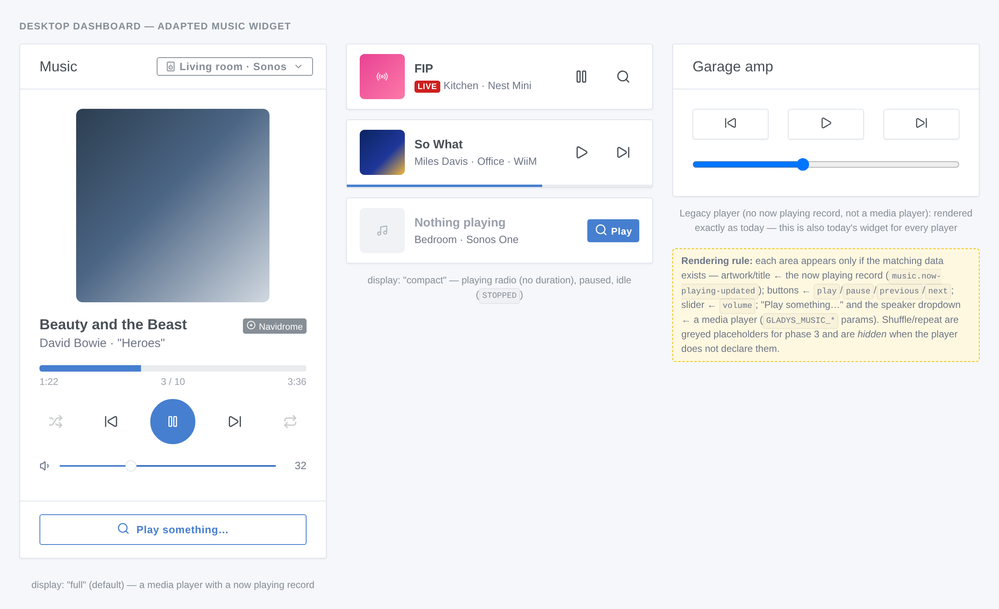
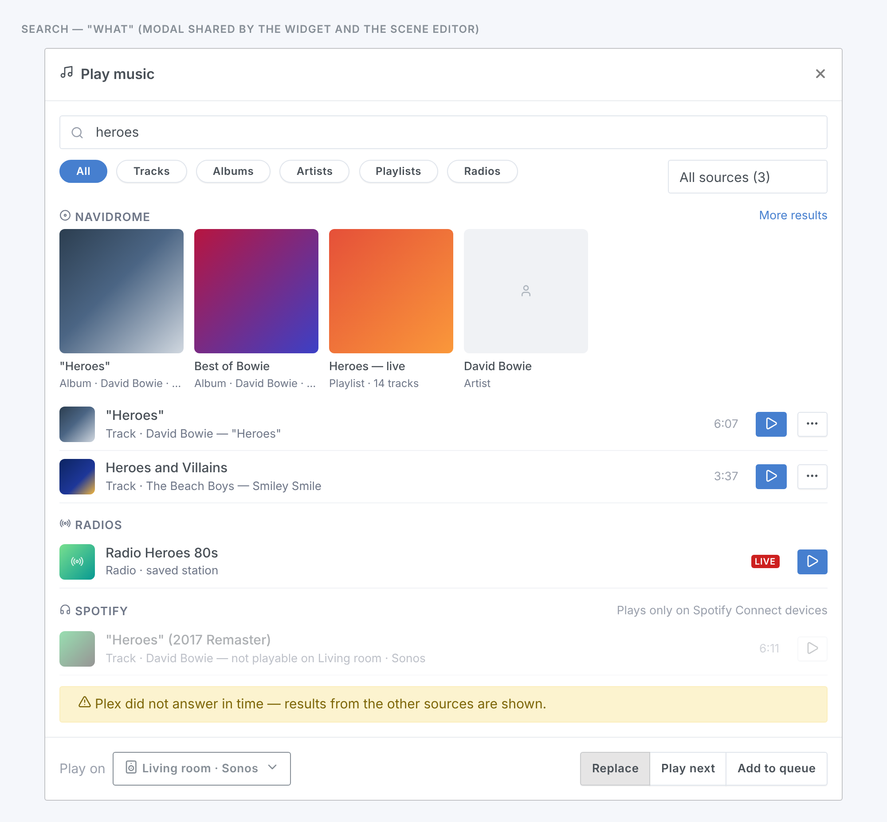
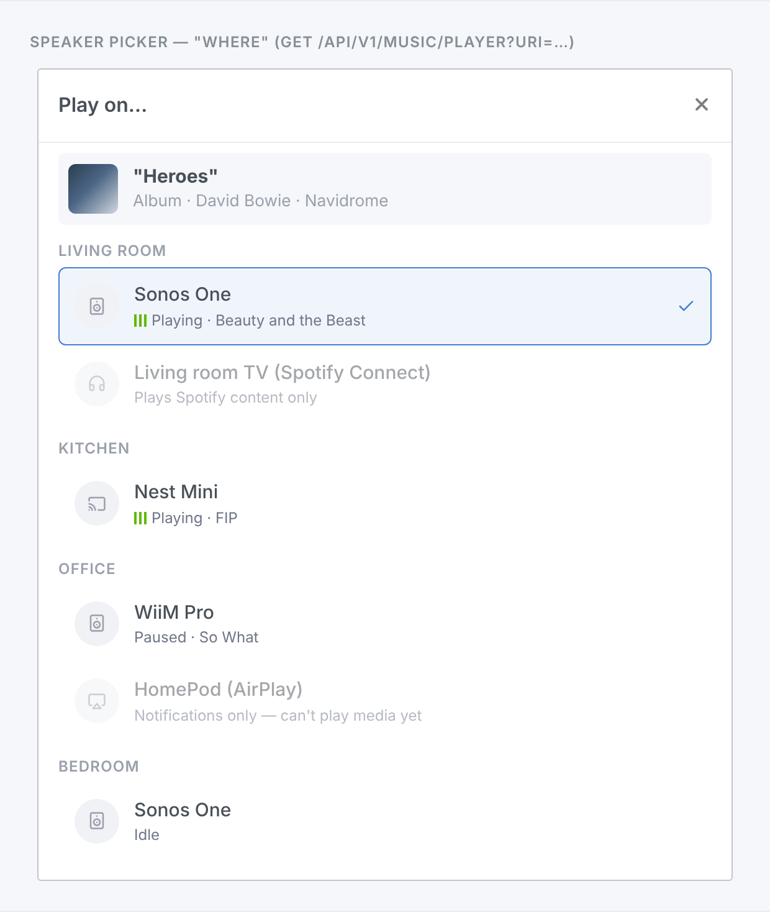
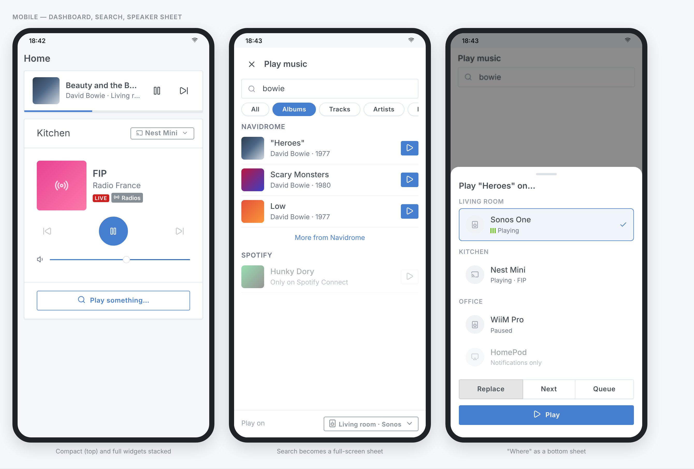
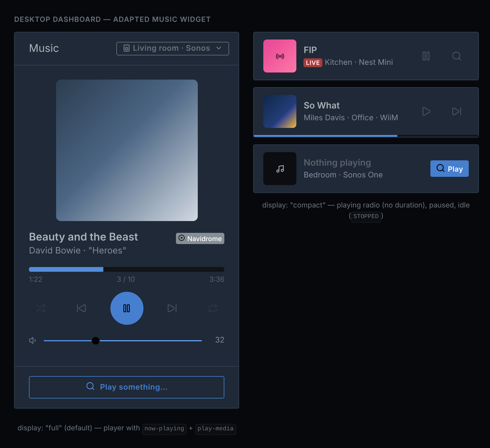
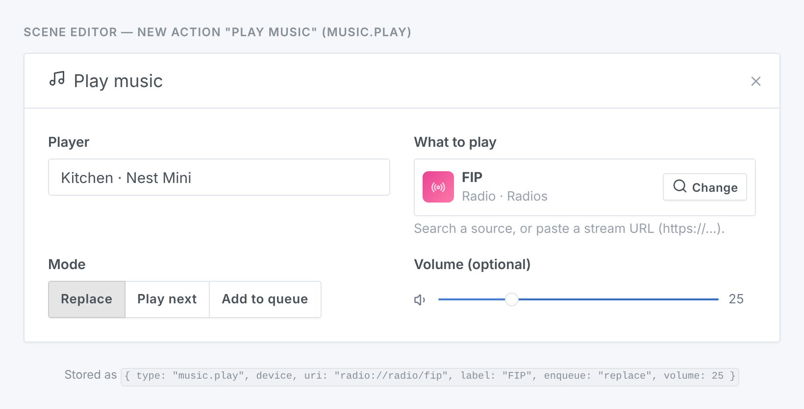

# Music: play any media, from any source, on any player

> **Living specification — source of truth.** This document specifies how Gladys Assistant describes music players and music sources, how "play *this* on *that*" is represented and routed, where the "now playing" state lives, and the contracts integrations (internal, MQTT, external) and the frontend rely on. **Rule: any PR that changes a music behavior or contract modifies this file in the same diff** — spec first, code second.
>
> Status: **draft, revision 2, for review.** Nothing in sections A–H is implemented. Section "Precedents" describes the code as of **v5.2.1** (`ff59ad8`, upstream `master` at the time of writing); nothing cited here exists only on an unreleased branch.
>
> Designed under `docs/specs/device-feature-categories.md` (section I audits it against that checklist) and modelled on `docs/specs/camera-ptz-control.md`.
>
> **Revision 2** (after the maintainer's review, [forum 11260/4](https://community.gladysassistant.com/t/11260/4)):
>
> - "Now playing" is no longer a JSON document in a feature's `last_value_string`: it is a **record owned by the core**, held in memory, with one entry point, a strict schema and typed transports in and out (E) — the maintainer's model, adopted as proposed and detailed.
> - The same rule is applied to the command: "play this" is a record the core builds, so it travels on **typed music transports** (internal call, `external-integration.music.play`, MQTT `…/music/play`) instead of riding in `setValue`'s `options` (C.3). The generic device path, the `external-integration.device.set-value` message and the MQTT state topics are untouched: "payload = the value as a string" holds everywhere.
> - **No new feature type at all.** A player is a device with a `playback_state`; what it can play (by URL, natively, with a queue) is declared per device in reserved `GLADYS_MUSIC_*` params — Matter's Content Launcher feature bits — instead of capability flags in `supported_options` (A.3, C.2).
> - The core owns the clock of the position and the lifecycle of the record (E.2, E.5); existing Sonos and Cast devices are upgraded at service start (F.2).
> - Closed: former open questions 2 (naming of the new types: there are none), 3 (now playing storage), 4 (MQTT JSON payload), 9 (artwork of relayed media), 11 (`play-media` on the generic value route).

## Context

Community request ([forum topic 11260](https://community.gladysassistant.com/t/11260), "Gladys Music"): ask Gladys to play **any music** — a track, an album, an artist, a playlist, a radio — from **any source** (Subsonic/Navidrome, Plex, Jellyfin, a DLNA server, web radios, Spotify…) on **any speaker** (Sonos, AirPlay, Google Cast, DLNA renderers, Denon/Marantz amplifiers, MusicCast, LinkPlay/WiiM, Lyrion/Squeezebox, Bose SoundTouch, MPD, VLC, Echo…), by voice (the Gladys AI), from a scene and from a dashboard widget.

Today the `music` category can change the volume, play, pause, skip, report a playback state and play a notification URL. It cannot say "play *this*": there is no notion of a media, of a source, or of what is currently playing, and the AI has no music tool at all.

The maintainer's answer (quoted in the forum thread) frames the work: it is **core** work, because sources and speakers are spread across many integrations and linking them is precisely the core's job; the existing **Music** widget must be adapted rather than duplicated; and the spec must settle five questions before any code:

| # | Question | Settled in |
|---|---|---|
| Q1 | How a player is described and what it can do — separate features or `supported_options` | A.1–A.3, C.2 |
| Q2 | How "play this" is represented, when a device command is a single value | A.4, C |
| Q3 | `play_media` or an extended `play_notification` | D |
| Q4 | Where the "now playing" state (title, artist, artwork) lives | E |
| Q5 | How a source declares itself, in the core and from external integrations | B |

### Design goals

1. **Players stay devices, sources are services.** A speaker is a thing in a room with features (volume, playback state); a catalog is not. A player is a device of the `music` category; a source is a service — internal or external — that implements a small search/resolve interface, exactly as a weather provider implements `weather.get`.
2. **Nothing that works today breaks.** Every existing `music` type, every scene, every MQTT setup and every external integration keeps working unchanged. New capabilities are additive.
3. **Features carry values; music records are core objects.** A feature holds one atomic value that every generic consumer can handle — scene triggers, the device page, the MQTT state topics, the AI's `device.get-state` (`device-feature-categories.md` rule 5). What the music domain needs beyond that — what is playing (E), and the request "play this" (C) — are **records** whose fields the core must understand. They live in `server/lib/music/`, behind one entry point with a strict schema, and travel on **typed transports** in both directions (a direct call for internal services, a dedicated host-API endpoint or WebSocket message for external integrations, a dedicated MQTT topic). The generic device path is not touched. A media itself is named by one string, the **media URI** (`ext-navidrome://album/al-42`): an identifier any consumer can carry.
4. **Capabilities are declared, never sent.** Matter's Content Launcher separates "play a URL" (`UrlPlayback`) from "play my own content" (`ContentSearch`), as feature bits of each endpoint. So does this spec: each media player declares them in reserved device params (`GLADYS_MUSIC_*`, A.3). They are not feature values, so no value picker, trigger or state topic ever sees them (C.2).
5. **The core never streams audio and never fetches a URL it was handed.** Sources hand playable URLs to players; artwork travels as bytes through the owning service. No transcoding, no stream proxy, no SSRF surface (G).
6. **A few dozen lines for an integration author.** Becoming a source is three SDK handlers; becoming a media player is one or two params and one `onMusicPlay` handler; reporting what plays is one `publishNowPlaying` call (B.4, F.4).

## Precedents (verified in the code, v5.2.1)

Paths are relative to the repository root.

**The music category today**

- `DEVICE_FEATURE_CATEGORIES.MUSIC = 'music'` and `DEVICE_FEATURE_TYPES.MUSIC` = `volume`, `play`, `pause`, `previous`, `next`, `playback_state`, `play_notification` (`server/utils/constants.js`, the `MUSIC` blocks). The types use underscores, unlike the kebab-case convention of `device-feature-categories.md` rule 7.
- `MUSIC_PLAYBACK_STATE = { PLAYING: 1, PAUSED: 0 }` is the only music enum.
- `ACTIONS.MUSIC.PLAY_NOTIFICATION = 'music.play-notification'` is the only music scene action (`server/lib/scene/scene.actions.js`): it compiles `action.text` with Handlebars, asks Gladys Plus for a TTS URL (`gateway.getTTSApiUrl`, plan-gated), then calls `device.setValue(device, playNotificationFeature, url, { volume })`. It targets a **device selector**, not a feature selector.
- `play_notification` is the only place where a **string** reaches a non-text feature: `server/lib/device/device.setValue.js` documents it ("a string is only a state on a text feature; on any other feature it is a one-shot command (a music notification URL for example): nothing to save").

**The three internal players** (`server/services/*`)

| Service | Features | Notification | Feedback |
|---|---|---|---|
| `sonos` (`@svrooij/sonos`) | `play`, `pause`, `previous`, `next` (1/1), `volume` (0–100), `playback_state` (read-only), `play_notification` — all `has_feedback: false`, `keep_history: false` | `sonosDevice.PlayNotification({ trackUri, onlyWhenPlaying: false, volume: options?.volume \|\| 45, timeout: 20, delayMs: 700 })` (`lib/sonos.setValue.js`); the library advertises restoring the previous playback afterwards | UPnP events: `AVTransport` → `playback_state`, `Volume` → `volume` (`sonos.onAvTransportEvent.js`, `sonos.onVolumeEvent.js`). The event's `CurrentTrackMetaData` is already parsed by the library into a `Track` (`Title`, `Artist`, `Album`, `AlbumArtUri`, `Duration`, `TrackUri`) but **ignored**; the position (`RelTime`) is read with `AVTransport.GetPositionInfo` |
| `google-cast` (`castv2-client`) | `play_notification` only | Launches `DefaultMediaReceiver`, `load({ contentId: url, contentType: 'audio/mp3' })`, restores the volume on `FINISHED` (`lib/google_cast.setValue.js`). Launching the receiver **kills** whatever app was casting: nothing is resumed | none: **no persistent connection** — a client is created per notification, after a 5 s bonjour scan that only keeps `name → IP` |
| `airplay` (`@lox-audioserver/node-airplay-sender`) | `play_notification` only | `ffmpeg -re -i <url>` decoded to PCM and pushed to the sender, capped at 5 minutes (`MAX_NOTIFICATION_DURATION_MS`, `lib/airplay.setValue.js`) | none |

No service reports a title, an artist or an artwork anywhere.

**The value paths**

- `device.setValue(device, deviceFeature, value, options = {})` calls `service.device.setValue(device, deviceFeature, value, options)`, with no type/min/max validation in the core; it saves the state only when `!has_feedback` (`saveState` for numbers, `saveStringState` for `text`/`select`).
- Both HTTP value routes (`post /api/v1/device/:device_selector/:feature_category/:feature_type/value`, `post /api/v1/device_feature/:device_feature_selector/value`, `server/api/controllers/device.controller.js`) emit `ACTION.TRIGGERED` with a `device.set-value` action, and that action converts every value to a number on any feature that is not `text`/`select`, aborting with `ACTION_VALUE_NOT_A_NUMBER` otherwise. **A URL cannot be sent to a music feature over HTTP today**, and no `options` can be passed.
- `saveStringState` writes `last_value_string` (TEXT column, no history) and emits the WebSocket event `device.new-string-state` `{ device, device_feature, last_value_string, last_value_changed }`. Inbound states carrying `text` (MQTT `.../feature/:id/text`, external `POST /api/integration/v1/state` with `text`) go through it **for any feature** (`server/lib/device/device.newStateEvent.js`).
- **Inbound states are fire-and-forget.** `POST /api/integration/v1/state` answers `200 { success: true }` as soon as the batch shape is valid: the controller does not await `saveStates`, which emits one `device.new-state` event per state; `device.newStateEvent` then logs and drops whatever it cannot save (unknown feature at `info`, save errors at `debug`). An integration never learns that a value was refused — the reason a record cannot be validated on this path.
- MQTT (`server/services/mqtt/lib/setValue.js`) publishes `value.toString()` on `gladys/device/{device_external_id}/feature/{feature_external_id}/state` (QoS 0, not retained); `options` are not part of the topic contract. Inbound, the core subscribes to `gladys/master/#` (`handler/handleGladysMessage.js`): `device/create`, `device/:id/feature/:id/{state,text,historical}`, `scene/:selector/start` — topics outside the feature pattern already exist. Retained messages get no special treatment: they are processed like fresh ones at each (re)subscription.
- External integrations: the proxy service (`server/lib/external-integration/externalIntegration.registerProxyService.js`) forwards `external-integration.device.set-value` `{ message_id, device: { external_id, selector, params }, device_feature: { external_id, category, type }, value }` and **drops `options`** — an external speaker never receives the notification volume today.

**`supported_options`**

- Table `t_device_feature_supported_option` (`migrations/20260619120000-create-device-feature-supported-option.js`, plus `value_string` in `20260814000000-…`): `{ value, label, sort_order }`, synced by `device.syncFeatureSupportedOptions` on create/update, validated by `server/utils/normalizeSupportedOptions.js` (integer values everywhere; string values only on `text`/`select`), loaded with every device through `getStandardDeviceIncludes()`.
- `camera.move` (`CAMERA_MOVE`) is the model: one feature, canonical integer values in the core, per-device subset in `supported_options` (`docs/specs/camera-ptz-control.md`). `AC_MODE`, `WATER_HEATER_MODE`, `SIREN_MODE`, the thermostat preset follow the same pattern.
- **Options are values a user sends.** The scene editor builds a value dropdown from the `supported_options` of **any** feature when no static labels exist (`front/src/utils/deviceFeatureValueOptions.js`, used by the `device.set-value` action, the device-state trigger and the condition); the dashboard renders them as buttons through `AdaptiveOptionControl`. A capability flag stored there would be offered as a value to send.
- The same spec **rejects structured payloads in `setValue`** ("Extending `setValue` with a structured `options` payload", `camera-ptz-control.md`, Alternatives): every consumer of the device-control path speaks one scalar per feature.

**Core objects kept in memory**

- External integrations' connection status: `connectionStatuses` (a `Map` in `server/lib/external-integration/index.js`), pushed with `external-integration.connection-status-updated`, served by `GET /api/v1/external_integration/:selector` — "kept in memory only (lost at restart, republished by the integration)" (`externalIntegration.setConnectionStatus.js`). The discovered devices of external integrations, Zigbee2mqtt and the MQTT Home Assistant discovery follow the same pattern (memory + event + read route).
- **A dedicated endpoint for a payload that is not a feature value**: `POST /api/integration/v1/camera/image` `{ device_external_id, image }` → `gladys.device.camera.setImage`, `404` if the device does not belong to the integration, `400` if it has no camera feature, its own rate limit (12 images/min per device) outside `POST /state` (`docs/specs/external-integrations/contracts/host-api-endpoints.md`).
- Host-API errors: a `BadParameters` thrown by the core becomes `400 { status, code: 'BAD_REQUEST', message }` (`errorMiddleware`); Joi-validated contracts turn the first failure into `BadParameters('<path>: <message>')` (`server/lib/energy-contract/contract.validate.js`). Rate limits are in-memory fixed windows per endpoint (`server/lib/external-integration/constants.js`).
- **Reserved device params.** Params named `GLADYS_*` are reserved for semantics the core defines and validates: `GLADYS_TRANSPORT` (`local` / `cloud` / `unreachable`), `GLADYS_TRANSPORT_DEGRADED` (`"true"` or absent) — declarative per-device data published by the integration, silently upserted on republication, rendered by the front as a pill; any undefined `GLADYS_*` key is refused with `400` (`server/lib/external-integration/constants.js`, `contracts/host-api-endpoints.md`). The thermostat keeps its configuration in core-named params too (`THERMOSTAT_*_FEATURE`, `thermostat.md`).
- Reachability paths: an external integration's connection is dropped by `integrationDisconnected` (WebSocket closed, status `DEGRADED`), by `stop` and by `uninstall` (status `STOPPED`, without going through `DEGRADED`). `device.destroy` emits no deletion event. The MQTT client's `message` callback passes `message.toString()` only (no `retain` flag), and `publish()` logs every payload at `debug`.
- The SDK (`@gladysassistant/integration-sdk` 0.15.0) re-authenticates after a WebSocket drop, re-reads `GET /device` and `GET /config`, emits `connected`, and **replays nothing**: the template republishes its discovered devices and transports from that event. Messages sent while disconnected are dropped.

**Providers and images in the external-integration contract**

- The core enumerates weather providers by duck typing: `server/lib/weather/weather.get.js` scans `stateManager.getAllKeys('service')` for `service.weather.get`. External integrations join through the proxy service, which wraps `sendCommand` (request/response over WebSocket, `message_id` + `external-integration.command-result`, 5 s default, 15 s for weather and widgets) and normalizes every payload ("the payload is never trusted").
- A new contract that the core does not consume through a dedicated type is a **capability field** usable by every type (`docs/specs/external-integrations/capabilities/provider-type.md`; `CAPABILITY_MANIFEST_FIELDS = ['widgets', 'scene_triggers', 'scene_actions', 'energy_contracts']` in `server/lib/external-integration/constants.js`).
- **Images**: the core never lets the browser load a third-party URL and never fetches an integration-supplied URL; content carries **keys**, the integration returns the bytes on demand (`widget.get-image`, raw base64, PNG/JPEG/WebP, ≤ 300 KB, ≤ 4096 px), and the core serves them from its own origin with a cache (`docs/specs/external-integrations/capabilities/dashboard-widgets.md` §6). The same section lists "media control with seek and volume" as a **core** widget matter.

**The AI**

- Tools live in `server/services/mcp/lib/buildSchemas.js` (`getAllTools`): `{ intent, config: { title, description, categories, inputSchema (zod) }, cb }`, exposed as `function` tools to the Gladys Plus chat (`server/lib/gateway/gateway.forwardMessageToAiChat.js`) after a category classification (`AI_CHAT_TOOL_CATEGORIES`: scenes, device_control, device_query, weather, web_and_time, other). Devices and rooms are matched by `findBySimilarity` (exact, then Levenshtein ≤ 3).
- **No music tool exists**: music devices only appear in the `scene.create` schema, for `music.play-notification`. `device.get-state` renders `last_value` only, for sensor, light, switch, AC and shutter features: music and text features are not covered (`server/services/mcp/lib/formatValue.js`, `selectFeature.js`).

**The widget**

- `front/src/components/boxs/music/MusicBox.jsx`: card titled with the device name, three buttons (previous, play/pause, next) and a volume range, driven by the `play`/`pause`/`previous`/`next`/`volume`/`playback_state` features, live through `device.new-state`. `EditMusicBox.jsx` lists `music` devices that have a `play` feature ("some music devices like the Nest Mini only expose the notification for now"). Box config: `{ type: 'music', device }`.

**Prior art outside Gladys** (what we keep and what we drop is argued in "Alternatives considered")

- **Home Assistant `media_player`**: one entity per player, a `supported_features` bitmask (PLAY_MEDIA, BROWSE_MEDIA, SEARCH_MEDIA, MEDIA_ENQUEUE, MEDIA_ANNOUNCE, GROUPING…), `play_media(media_content_id, media_content_type, enqueue: add|next|play|replace, announce)`, attributes `media_title`, `media_artist`, `media_album_name`, `media_duration`, `media_position` + `media_position_updated_at` (clients extrapolate the position), artwork served through `/api/media_player_proxy/<entity>?token=…` because it often lives on the LAN. `media-source://` URIs are resolved by the core into a plain URL before reaching URL-only players. Since 2025.6 the `HassMediaSearchAndPlay` intent searches then plays the first result, and is exposed as an LLM tool.
- **Music Assistant**: music providers vs player providers; URIs `<provider>://<media_type>/<item_id>`; `search` returns tracks/albums/artists/playlists/radios; server-side queues; announcements snapshot and resume the previous queue; MA **streams every source itself** to every player.
- **Matter** (checked against `@matter/types`, spec 1.6): the *Speaker* device type is On/Off (mute) + Level Control (volume). The *Media Playback* cluster has **one command per transport action** (`Play`, `Pause`, `Stop`, `StartOver`, `Previous`, `Next`, `SkipForward`, `SkipBackward`, `Seek`), a `CurrentState` attribute (Playing, Paused, NotPlaying, Buffering) and, with the `AdvancedSeek` feature, `Duration` and `SampledPosition { updatedAt, position }`. The *Content Launcher* cluster has two features: `UrlPlayback` (command `LaunchURL`) and `ContentSearch` (command `LaunchContent`, the device's own catalog). Matter has no title/artist/artwork attributes and no model of a music catalog.

## A. Data model

### A.1 What a player is (Q1)

Two notions, read from the device itself — no new feature type:

- A **player** is a device with a `music` / `playback_state` feature. It shows in the Music widget with the transport features it has, and it can report what it plays (E). A record of what plays cannot be read without a transport state (is the position moving? is the player idle?), hence the requirement — the maintainer's "refuse if the device is not a player". A device that only exposes `play_notification` (a Nest Mini today) is not a player.
- A **media player** is a player that can receive "play this" (C). It says so with **reserved device params** (A.3): it plays media by URL, and/or it plays natively the catalog of its own service.

**Decision on Q1 — the transport stays one feature per command; capabilities are declared, never sent.**

- The existing transport types (`play`, `pause`, `previous`, `next`, `volume`, `playback_state`, `play_notification`) are **kept unchanged**. They are deployed on three internal services and in external integrations, users' scenes reference them by feature selector, and they already are Matter's model: the Media Playback cluster has one command per transport action next to one `CurrentState` attribute. A missing command (`stop`, phase 3) is added the same way, as one more type mapping one Matter command.
- `camera.move` groups the values of **one** quantity — the directions of one movement, released by `STOP = 0` — into one feature. Transport commands are not values of one quantity, and the standard keeps them apart. A single `transport` feature would also break every scene that uses the current ones (see Alternatives; the final call is open question 1).
- `supported_options` keep their meaning: **values a user sends**, rendered as controls (a future `repeat` feature: off / one / all). What a player *can play* is not a value anyone sends: it is declared once per device, in reserved params (A.3), the way Matter declares a cluster's feature bits per endpoint.

### A.2 New types and enum changes

**No new feature type.** What plays is a core record (E), the play request is a core command (C), and what a player can play is declared in params (A.3).

**`MUSIC_PLAYBACK_STATE` is extended, append-only:**

```js
const MUSIC_PLAYBACK_STATE = {
  PAUSED: 0, // unchanged
  PLAYING: 1, // unchanged
  STOPPED: 2, // new: nothing loaded, or playback ended (Matter NotPlaying)
  BUFFERING: 3, // new: loading, about to play (Matter Buffering)
};
```

`0` and `1` keep their meaning, so every `=` condition and the current widget are unaffected. A player that cannot tell `STOPPED` from `PAUSED` keeps publishing `0`. The widget uses `STOPPED` to show its idle state (H.1). Scenes using `>`/`<` on this feature change meaning (F.5). Existing players raise their `playback_state` `max` to 3 (F.2).

**New request enum (not stored, used by the API, the scene action, the AI tool and the play request of C.3):**

```js
const MUSIC_ENQUEUE = {
  REPLACE: 'replace', // default: stop what plays, play this
  NEXT: 'next', // insert after the current item
  ADD: 'add', // append at the end of the queue
};
```

**New media-type list (search filter, URI segment, item `type`):** `track`, `album`, `artist`, `playlist`, `radio`. Append-only (`podcast`, `audiobook` are expected later). Lowercase singular, the Music Assistant vocabulary.

**No schema migration.** `t_device_param` and `t_device_feature` are unchanged, and nothing music-related is persisted outside the existing tables (E.5).

### A.3 What a media player declares: reserved device params

A media player declares what it can play with params of the reserved `GLADYS_*` namespace — the one the core already validates for `GLADYS_TRANSPORT` (`server/lib/external-integration/constants.js`):

| Param | Value | Meaning | Standard |
|---|---|---|---|
| `GLADYS_MUSIC_URL_PLAYBACK` | `"true"` / `"false"` | plays media **by URL**: any streamable source, direct URLs | Matter Content Launcher `UrlPlayback` |
| `GLADYS_MUSIC_NATIVE_PLAYBACK` | `"true"` / `"false"` | plays **natively** the media of the source of its own service | Matter Content Launcher `ContentSearch` |
| `GLADYS_MUSIC_ENQUEUE` | `"true"` / `"false"` | honours `next` and `add`; without it, only `replace` is sent | Home Assistant `MEDIA_ENQUEUE` |

- Absent means `false`. `"false"` exists so that a declaration can be **withdrawn**: a republication only inserts or updates params (`upsertDeviceParams`), it never removes one, so an integration revokes a capability by publishing `"false"` (the trap `GLADYS_TRANSPORT_DEGRADED` fell into).
- Any other value, or an undefined `GLADYS_MUSIC_*` key, is refused — `400` on an external publication (the existing reserved-namespace rule), `BadParameters` on every other path that writes params: `device.create`, `device.addParam`, `device.setParam`. They are refused on a device that is not a player (no `playback_state`), and `GLADYS_MUSIC_NATIVE_PLAYBACK` on a device whose service is not a source (no `music_source` in the manifest, no `service.music.search`).
- Who writes them: an internal service in the devices it creates (and in its existing devices at start, F.2); an external integration in its device publication, silently upserted on republication like `GLADYS_TRANSPORT`; the user in the MQTT setup UI (F.3). They are the owner's declaration: the user does not override an external integration's (its next republication would restore them anyway).
- `device.create` deletes every param missing from the posted device: a page that re-posts a device keeps its params, as for any param today. The MQTT setup UI drops the `GLADYS_MUSIC_*` params when the device loses its `playback_state` feature.

| Device | URL | Native | Enqueue |
|---|---|---|---|
| Sonos, Google Cast, LinkPlay/WiiM, MPD | ✓ | | ✓ |
| AirPlay (the service keeps the list, C.3) | ✓ | | ✓ |
| DLNA renderer | ✓ | | ✓ only if the integration keeps a list or the renderer has `SetNextAVTransportURI` |
| Lyrion player (its integration is also a source) | ✓ | ✓ | ✓ |
| Spotify Connect device (the Spotify integration is a source) | | ✓ | — (the Web API queues one track at a time) |
| A Plex client that cannot be driven, a TV that only reports its track | | | — a player, not a media player |

**Why params, and not a feature or `supported_options`:** the declaration is per device, persisted with it, written by its owner and validated by the core, like `GLADYS_TRANSPORT` and the thermostat's configuration params. It is **not a value**: no value picker, trigger, chart or MQTT state topic ever sees it, so nothing in the generic device path needs an exception. A feature that holds no value (revision 2's first draft) needed exclusions in `setValue`, `newStateEvent`, eleven feature pickers and the MQTT catalog; capability flags in `supported_options` (revision 1) were offered as values by the scene editor (Alternatives).

### A.4 The media URI (Q2)

A media is named by **one string**:

```
<source>://<type>/<id>
```

- `<source>` — the **source key** (B.1): the service's key in the state manager (`radio`, `ext-navidrome`, `ext-spotify`). Lowercase, `[a-z0-9-]`, ≤ 64 chars.
- `<type>` — one of the media types of A.2.
- `<id>` — opaque to the core, chosen by the source, URL-encoded, ≤ 512 chars. It must **not** carry credentials (G.3).

Examples: `ext-navidrome://album/al-42` (an external Navidrome integration), `radio://radio/fip` (the internal `radio` source), `ext-spotify://playlist/37i9dQZF1DXcBWIGoYBM5M`.

**Direct URLs.** `http://…` and `https://…` are accepted as a media URI of implicit type `track` with no source: "play this stream". They exist for scenes and power users (a web radio URL pasted in a scene), are playable only on players declaring URL playback, and are refused from the AI tools (G.1).

**Stability.** Scenes store URIs, so a source MUST keep `<id>` stable across rescans and restarts (a Navidrome id, not a row number). A stored URI that no longer resolves fails with `404 MUSIC_MEDIA_NOT_FOUND`, and the scene action reports it. The source key is the service selector: a URI is meaningful on its own instance only, like every selector stored in a scene.

Why a string: a media is **named**, and a name is the one thing every consumer can carry — a scene field, a chat tool argument, a dashboard box setting, a log line. The URI is an identifier, opaque outside `server/lib/music/`. The structure a speaker needs (one URL per track, titles, artwork keys) is a separate record, built **by the core at play time** (C.1), never stored and never typed by a user.

## B. Sources (Q5)

### B.1 What a source is

A **source** is a service that can search a catalog and turn a media URI into something playable. It is identified by its **source key** = its state-manager service key (the same key `weather.get` iterates). One service is at most one source. A service can be a source **and** own players (Spotify, Plex/Plexamp, Lyrion, MPD, Music Assistant): nothing forbids it, and C.2 relies on it.

A source declares, once, its **descriptor**:

```json
{
  "name": "Navidrome",
  "media_types": ["track", "album", "artist", "playlist"],
  "streamable": true
}
```

- `name` — display name (≤ 40 chars).
- `media_types` — the subset of A.2 types it can search and resolve.
- `streamable` — `true` when `resolve` returns HTTP(S) URLs any player declaring URL playback can fetch; `false` for a source whose content has no stream outside its own players (Spotify: no stream URL exists outside Spotify Connect).
- Native playback is not a property of the source but of each of its devices (`GLADYS_MUSIC_NATIVE_PLAYBACK`, A.3): the Spotify integration's Connect devices declare it, a Plex client that cannot be driven does not. A `streamable: false` source none of whose devices declares it plays nowhere; `GET /api/v1/music/source` says so (C.4).

### B.2 The source interface

Every source implements three functions — duck-typed on internal services exactly like `service.weather.get`, and forwarded over WebSocket for external integrations (B.4):

| Function | Input | Output | Timeout |
|---|---|---|---|
| `music.search(query)` | `{ query, types[], limit, offset, language }` | `{ items: MediaItem[], has_more }` | 8 s |
| `music.resolve(request)` | `{ uri, player: { selector, service } }` | `{ items: PlayableItem[] }` — **only for `streamable` sources** | 8 s |
| `music.getImage(key)` | `image_key` | raw bytes (PNG/JPEG/WebP, ≤ 300 KB, ≤ 4096 px) | 15 s |

Plus the descriptor: `music.getDescriptor()` for internal services, the manifest field for external ones.

**`MediaItem`** — what a search returns, and the only media shape the frontend and the AI ever see:

```json
{
  "uri": "ext-navidrome://album/al-42",
  "type": "album",
  "title": "\"Heroes\"",
  "subtitle": "David Bowie · 1977",
  "artist": "David Bowie",
  "album": null,
  "duration": null,
  "image": "cover-al-42",
  "playable": true
}
```

- `uri` (required) — A.4, and its `<source>` must equal the answering source's key (the core rejects others: a source cannot vend another source's URIs).
- `type` (required), `title` (required, ≤ 200), `subtitle` (≤ 200, free line shown under the title), `artist`/`album` (≤ 200, optional, used by the AI to disambiguate), `duration` (seconds, tracks only).
- `image` — an **image key** (`^[a-z0-9][a-z0-9-]{0,63}$`, the widget-image rule), never a URL. The front loads it from the core (B.5).
- `playable` — `false` for an item that can only be expanded (a genre, phase 2 browse).

**`PlayableItem`** — what `resolve` returns, handed to the player and **never** returned to a client (it can contain stream tokens, G.3):

```json
{
  "url": "http://192.168.1.20:4533/rest/stream?id=tr-1&u=gladys&t=…&s=…",
  "mime_type": "audio/flac",
  "title": "Beauty and the Beast",
  "artist": "David Bowie",
  "album": "\"Heroes\"",
  "duration": 216,
  "image": "cover-al-42",
  "uri": "ext-navidrome://track/tr-1"
}
```

`url` is `http:`/`https:` only; `mime_type` optional (the player sniffs otherwise); `duration` absent for a live radio. `uri` is **required**: the media URI of this very item, of the answering source (the same source check as `MediaItem`; the core fills it with the requested URI when a resolve returns a single item without one). It is what a player echoes in its now playing record, and what makes the record's `image` a source key (E.7): an item with an `image` and no `uri` is dropped. A resolve returns **at most 500 items** — an artist resolves to the source's choice (top tracks, shuffled discography…): the source knows its catalog better than the core. Ordering is the play order.

**Search rules.** `query` is free text (≤ 200 chars, trimmed, non-empty). `types` empty = all the source's `media_types`. `limit` 1–50 (default 20), `offset` ≥ 0 — **pagination is per source**: the aggregated API (C.4) passes `limit`/`offset` to each source and returns each source's `has_more`; there is no global ranking across sources (relevance scores of two catalogs are not comparable). Each source returns items ordered by its own relevance; the core keeps that order.

### B.3 Internal sources

An internal service becomes a source by exposing `service.music`:

```js
// server/services/radio/index.js — sketch
return {
  start, stop,
  music: {
    getDescriptor: () => ({ name: 'Radios', media_types: ['radio'], streamable: true }),
    search: ({ query, limit, offset }) => radioHandler.search(query, limit, offset),
    resolve: ({ uri }) => radioHandler.resolve(uri),
    getImage: (key) => radioHandler.getImage(key),
  },
};
```

The same `service.music` object carries `play(device, request)` when the service owns media players (C.3) — a service can be a source, a player host, or both. `server/lib/music/` lists sources the way `weather.get.js` lists providers: `stateManager.getAllKeys('service')`, keep those with `service.music && typeof service.music.search === 'function'`, sorted by key.

**Reference source shipped with the feature: `radio`** (new internal service, phase 1). The user saves web radios (name, stream URL, optional logo uploaded as a dashboard asset) from its integration page; search matches names; `resolve` returns the one URL. It has no network dependency, exercises the whole chain (search → play → now playing → widget) on Sonos and Cast from day one, and covers "joue FIP dans la cuisine" — the single most common voice request in the forum thread. A public directory (radio-browser.info) is a phase-3 option of that service, not a core concern.

### B.4 External sources (store integrations)

**Manifest — new capability field `music_source`** (added to `CAPABILITY_MANIFEST_FIELDS`, usable by every type: a `device` integration that also owns players, or a `provider` integration that is a catalog only):

```json
{
  "manifest_version": 1,
  "type": "provider",
  "name": "Navidrome",
  "music_source": {
    "media_types": ["track", "album", "artist", "playlist"],
    "streamable": true
  }
}
```

`name` defaults to the manifest `name`. The source key is the integration's selector (`ext-navidrome`). Validation errors name their rule, as `validateManifest` does today.

**WebSocket messages** (core → integration, `message_id` + `external-integration.command-result` ack, the `<domain>.<action>` naming convention):

| Type | Payload | `command-result` `data` | Timeout |
|---|---|---|---|
| `external-integration.music.search` | `{ message_id, query, types, limit, offset, language }` | `{ items, has_more }` | 8 s |
| `external-integration.music.resolve` | `{ message_id, uri, player: { selector, service } }` | `{ items }` | 8 s |
| `external-integration.music.get-image` | `{ message_id, image_key }` | `{ image }` (raw base64, no data-URI prefix) | 15 s |

Every answer goes through a core normalizer (whitelisted keys, lengths, URI source check, `url` scheme check, item cap); an invalid item is dropped and logged at warn level with the integration selector, the rest of the answer is kept. An integration that does not know a type ignores it (existing protocol rule), so old SDKs time out cleanly.

**SDK (`@gladysassistant/integration-sdk`)** — three handlers, mirroring `onWeatherGet` / `onWidgetGetImage`:

```js
gladys.onMusicSearch(async ({ query, types, limit, offset, language }) => {
  const r = await subsonic.search3(query, { limit, offset });
  return {
    items: r.albums.map((a) => ({
      uri: gladys.musicUri('album', a.id), // → 'ext-navidrome://album/<id>'
      type: 'album',
      title: a.name,
      subtitle: `${a.artist} · ${a.year}`,
      artist: a.artist,
      image: `cover-${a.coverArt}`,
      playable: true,
    })),
    has_more: r.albums.length === limit,
  };
});

gladys.onMusicResolve(async ({ uri }) => ({
  items: (await subsonic.tracksOf(uri)).map((t) => ({
    uri: gladys.musicUri('track', t.id), url: subsonic.streamUrl(t.id), title: t.title,
    artist: t.artist, album: t.album, duration: t.duration, image: `cover-${t.coverArt}`,
  })),
}));

gladys.onMusicGetImage(async (key) =>
  (await sharp(await subsonic.coverArt(key.slice(6))).resize(300).webp().toBuffer()).toString('base64'),
);
```

SDK side each handler is one `on…` setter, one `case` in `_handleMessage` dispatching to `_runCommand`, typings, a `gladys.fake.music*` trigger in `lib/testing.js` and a dev-mode validator (the `widget-content.js` pattern).

**Spec placement.** At implementation time, the external part of this section moves to `docs/specs/external-integrations/capabilities/music-source.md` (one file per capability, `docs/specs/external-integrations/README.md`), with a row in the capability table of `provider-type.md`, and this file links to it — in the same diff, per the living-spec rule.

### B.5 Images

The images of search results and of "now playing" follow the widget-image doctrine verbatim: **keys only, bytes on demand, served from Gladys' origin.**

**A key belongs to whoever named the media.**

- Source images: `GET /api/v1/music/source/:source/image/:image_key` → `music.getImage(key)` on that source. This covers search results **and** the artwork of a now playing record that carries a `uri` (E.7): the record's `image` is then a key of the URI's source, so a player relaying a Navidrome album just echoes the key it received and keeps no bytes — an MQTT player included.
- Player images: `GET /api/v1/music/player/:device_selector/image/:image_key` → `music.getImage(key)` on **the service owning the device**, only for a record **without** `uri` (content started outside Gladys: the Spotify app, a line-in, the Sonos app). An internal Sonos service fetches the `AlbumArtUri` from the speaker it already talks to; an external player answers `music.get-image`. A player that never reports such content implements no image handler.
- Same validation, limits, error codes and cache policy as `dashboard-widgets.md` §6 (≤ 300 KB, ≤ 4096 px, 1 h cache per `(service, key)`, ≤ 100 entries per service LRU, ≤ 4 in flight per service, concurrent requests for one key share one command). Keys are immutable for the life of the cache.
- Allowlist: a source key is served only if it appeared in that source's last 200 search/resolve items or in a current now playing record whose `uri` belongs to that source; a player key only if it is in that device's current record. Any other key `404`s without a command sent.

## C. "Play this" (Q2)

### C.1 The play pipeline

One core function, `gladys.music.play({ device, uri, enqueue = 'replace', volume })`, used by the HTTP route, the scene action, the AI tool and the widget — the **only** way to make a player play a media:

1. **Player.** `device` is a media player (A.1), else `400 MUSIC_NOT_A_PLAYER`.
2. **Parse** the URI (A.4), else `400 MUSIC_INVALID_URI`. Find the source by key, else `404 MUSIC_SOURCE_NOT_FOUND`.
3. **Compatibility** (C.2), else `409 MUSIC_PLAYER_INCOMPATIBLE` with the reason (`not_streamable`: the source has no stream and the player does not play it natively; `no_url_playback`: the player does not declare URL playback; `unreachable`: its owner is not connected, E.5). `enqueue` other than `replace` on a player that does not declare `GLADYS_MUSIC_ENQUEUE` → `409 MUSIC_ENQUEUE_UNSUPPORTED`.
4. **Resolve.** *Native* route: nothing to resolve. *Stream* route: `source.music.resolve({ uri, player })` → `PlayableItem[]` (empty → `404 MUSIC_MEDIA_NOT_FOUND`). A direct `http(s)` URI resolves to one item `{ url: uri }` without any call.
5. **Volume.** If `volume` (0–100) is given and the player has a `volume` feature, `device.setValue(volumeFeature, volume)` first — the existing path, no new contract.
6. **Request.** Build the play request (C.3) and send it to **the service owning the device** on the music transport of its kind (internal call, `external-integration.music.play`, MQTT `…/music/play`).
7. **Answer** `{ device, uri, route, items_count }` — never the URLs.

**Why not `setValue`.** Revision 1 sent the URI as the value of a `play-media` feature and the expansion in `setValue`'s 4th argument, `options`. That is a record riding in the generic device path: every transport of that path would have needed a side channel (an `options` field in `external-integration.device.set-value`, a JSON exception on the MQTT state topic), whose shape depends on the feature type — the structured payload `camera-ptz-control.md` rejected, and the command-side twin of the now playing problem (E.1). "Play this" is a core command, like "now playing" is a core record: one entry point, a record built and validated by the core, typed transports. The generic path keeps carrying values only.

### C.2 Choosing a compatible player

A media player `P` can play a media `M` of source `S` according to its own declarations (A.3):

| | `P` declares native playback and belongs to `S`'s service | otherwise |
|---|---|---|
| `P` declares URL playback | **native** (wins) | **stream** if `S.streamable` or `M` is a direct URL, else incompatible |
| `P` does not declare URL playback | **native** | incompatible |

Native is Matter's `ContentSearch` (the device plays its own catalog), stream is Matter's `UrlPlayback`. Native wins when both hold: a Lyrion player playing the Lyrion library natively keeps gapless playback and the server's own queue. A player whose owner is not reachable is never compatible (E.5).

This is the whole answer to **"a source that only plays at home" (Spotify Connect)**: the Spotify integration declares `music_source` with `streamable: false`, and its Connect devices declare `GLADYS_MUSIC_NATIVE_PLAYBACK` only. Spotify media are compatible with those devices only; a Navidrome album is compatible with the Sonos (URL playback) and not with the Spotify devices. Nothing Spotify-specific exists in the core. The same rule covers Echo devices driven by an Alexa integration, Plexamp, Music Assistant (a `streamable: false` source whose players declare native playback).

- Everything is per device: a Plex integration declares native playback on the clients it can drive and not on the others, a Home Assistant bridge declares URL playback on the speakers that accept URLs and not on its Spotify entities.
- One speaker exposed by two integrations (a Sonos speaker seen by the Sonos service and as a Spotify Connect device) is two players; the speaker picker shows both, each with what it can play.
- The rule is computed by the core only: the API returns `compatible` and `reason` (C.4) and the front never re-implements it.

When only a **room** (or nothing) is given — AI and scenes —, `gladys.music.choosePlayer({ uri, room?, user? })`:

1. candidates = reachable media players compatible with the media (above); if a room is given, those in that room;
2. none → `MUSIC_NO_COMPATIBLE_PLAYER` (the AI explains which players exist and why they do not fit);
3. one → it;
4. several → the one currently `PLAYING` (the user means "this speaker"; its owner is reachable, so its `playback_state` is current), then the one whose now playing record changed most recently (E), then **ambiguous**: the AI asks back with the list, the scene editor never gets there (a scene always names a device).

### C.3 What a player receives

**The play request** — a record built by the core, identical on every transport:

```json
{
  "uri": "ext-navidrome://album/al-42",
  "route": "stream",
  "enqueue": "replace",
  "media": { "type": "album", "title": "\"Heroes\"", "subtitle": "David Bowie · 1977", "image": "cover-al-42" },
  "items": [
    { "url": "http://…", "mime_type": "audio/flac", "title": "Beauty and the Beast", "artist": "David Bowie",
      "album": "\"Heroes\"", "duration": 216, "image": "cover-al-42", "uri": "ext-navidrome://track/tr-1" }
  ]
}
```

- `media` — what the user picked, for the player's own display: `type`, `title`, `subtitle`, `image` of the `MediaItem` (B.2) when the caller has it (widget, AI), else built from the first resolved item. Its URI is the top-level `uri`.
- `items` — the `PlayableItem`s in play order (B.2), each with its own `uri`; absent on the native route, where the player's own service knows what `uri` means. At most 500 items on internal and WebSocket transports, 100 on MQTT; the core truncates, and the answer's `items_count` says what was sent.
- `image` keys are the source's (B.5); a player echoes them in its now playing record (E.7) and keeps no bytes.
- The record evolves by adding optional fields only; players ignore the fields they do not know.

**Queueing is declared.** `enqueue` is `next` or `add` only for a player that declares `GLADYS_MUSIC_ENQUEUE` (C.1 refuses otherwise). Playing an album with `replace` needs no declaration, but it needs someone to chain the items: the speaker (Sonos, Cast, MPD, LinkPlay, LMS queues; `SetNextAVTransportURI` on many DLNA renderers) or, when it has no queue, the integration — the protocol's job, which the core does not take over (Alternatives). An integration that keeps such a list can honour `next` and `add` and declares the param; one that cannot (Spotify's Web API queues one track at a time) does not.

**Transports** — one per kind of integration, the mirror of the now playing transports (E.4):

| Player | Receives | Acknowledgement |
|---|---|---|
| Internal service | `service.music.play(device, request)` | the returned promise |
| External integration | WebSocket `external-integration.music.play` `{ message_id, device: { external_id, selector, params }, request }`; SDK `gladys.onMusicPlay(async (device, request) => …)` | `external-integration.command-result`, 10 s |
| MQTT device | topic `gladys/device/{device_external_id}/music/play`, payload = the request as JSON, QoS 1, not retained | none (MQTT has no return channel) |

- The MQTT state topics are untouched: `gladys/device/…/feature/…/state` keeps carrying `value.toString()` for every feature. The music topic is a documented message on a topic of its own, like the inbound now playing topic (E.4).
- `external-integration.device.set-value` is untouched (no `options` field). An integration that does not know `music.play` ignores it (existing protocol rule) and the core reports a timeout.
- Sonos: `route: stream` → `RemoveAllTracksFromQueue` (`replace`) or `AddURIToQueue` (`EnqueuedAsNext` for `next`), then `Play`. `route: native` does not occur (Sonos is not a source in v1).

A player MUST acknowledge once playback of the **first item** has been accepted by the speaker; it loads the rest of the queue afterwards (500 `AddURIToQueue` calls do not fit in any timeout). Failure → `success: false` with a human-readable `error`.

The MQTT play request is published with QoS 1 through a new publish path that never logs the payload — today `publish()` logs every message at `debug`, stream tokens included (G.3).

### C.4 HTTP API

All routes are user-authenticated (standard API auth, any role — see open question 3).

| Route | Body / query | Answer |
|---|---|---|
| `GET /api/v1/music/source` | — | `[{ source, name, media_types, streamable, native_players, status }]`; `native_players` = how many devices of its service declare native playback (a `streamable: false` source with none plays nowhere); `status` = `ok` / `not_connected` (external integration down) |
| `GET /api/v1/music/search` | `query`, `types` (csv), `source` (csv, default all), `limit`, `offset`, `player` (optional device selector) | `{ sources: [{ source, name, status: 'ok' \| 'timeout' \| 'error', error?, items, has_more }] }` — fan-out in parallel, 8 s per source, a slow source never blocks the others' results; with `player`, each item carries `compatible` and `reason` (C.2) |
| `GET /api/v1/music/player` | `uri` (optional), `room` (optional) | players with `{ device_selector, name, room, reachable, url_playback, native_source, enqueue, playback_state, now_playing, compatible?, reason? }` (`native_source`: the key of its service's source when it declares native playback, else `null`); with `uri`, each says whether it can play it (the speaker picker of H.3) |
| `GET /api/v1/music/player/:device_selector` | — | the same object for one device — what the widget loads (H.1) |
| `POST /api/v1/music/play` | `{ device_selector, uri, enqueue?, volume? }` | C.1; `202` once the player acknowledged |
| `GET /api/v1/music/source/:source/image/:image_key` | — | B.5 |
| `GET /api/v1/music/player/:device_selector/image/:image_key` | — | B.5 |

**One entry point.** There is no feature to write: generic clients (Node-RED, HTTP scripts) use `POST /api/v1/music/play`, scenes use the `music.play` action (H.4).

### C.5 Fixture — a player device (external WiiM integration)

```json
{
  "name": "WiiM Pro — Kitchen",
  "external_id": "ext:wiim:a1b2c3",
  "features": [
    { "name": "Play", "external_id": "ext:wiim:a1b2c3:play", "category": "music", "type": "play",
      "min": 1, "max": 1, "read_only": false, "has_feedback": false, "keep_history": false },
    { "name": "Pause", "external_id": "ext:wiim:a1b2c3:pause", "category": "music", "type": "pause",
      "min": 1, "max": 1, "read_only": false, "has_feedback": false, "keep_history": false },
    { "name": "Next", "external_id": "ext:wiim:a1b2c3:next", "category": "music", "type": "next",
      "min": 1, "max": 1, "read_only": false, "has_feedback": false, "keep_history": false },
    { "name": "Previous", "external_id": "ext:wiim:a1b2c3:previous", "category": "music", "type": "previous",
      "min": 1, "max": 1, "read_only": false, "has_feedback": false, "keep_history": false },
    { "name": "Volume", "external_id": "ext:wiim:a1b2c3:volume", "category": "music", "type": "volume",
      "min": 0, "max": 100, "read_only": false, "has_feedback": true, "keep_history": false },
    { "name": "Playback state", "external_id": "ext:wiim:a1b2c3:playback-state", "category": "music",
      "type": "playback_state", "min": 0, "max": 3, "read_only": true, "has_feedback": false, "keep_history": false },
    { "name": "Notification", "external_id": "ext:wiim:a1b2c3:play-notification", "category": "music",
      "type": "play_notification", "min": 1, "max": 1, "read_only": false, "has_feedback": false, "keep_history": false },
  ],
  "params": [
    { "name": "GLADYS_MUSIC_URL_PLAYBACK", "value": "true" },
    { "name": "GLADYS_MUSIC_ENQUEUE", "value": "true" }
  ]
}
```

The features are today's; the two params make the WiiM a media player that plays by URL and queues (A.3). What it plays is not a feature: the integration publishes it with `publishNowPlaying` (E.4).

### C.6 Fixture — search

`GET /api/v1/music/search?query=heroes&types=album,track&limit=2`

```json
{
  "sources": [
    {
      "source": "ext-navidrome",
      "name": "Navidrome",
      "status": "ok",
      "has_more": true,
      "items": [
        { "uri": "ext-navidrome://album/al-42", "type": "album", "title": "\"Heroes\"",
          "subtitle": "David Bowie · 1977", "artist": "David Bowie", "image": "cover-al-42", "playable": true },
        { "uri": "ext-navidrome://track/tr-7", "type": "track", "title": "\"Heroes\"",
          "subtitle": "David Bowie — \"Heroes\"", "artist": "David Bowie", "album": "\"Heroes\"",
          "duration": 367, "image": "cover-al-42", "playable": true }
      ]
    },
    { "source": "radio", "name": "Radios", "status": "ok", "has_more": false, "items": [] },
    { "source": "ext-spotify", "name": "Spotify", "status": "timeout", "has_more": false, "items": [] }
  ]
}
```

### C.7 Fixture — "play this"

`POST /api/v1/music/play`

```json
{ "device_selector": "wiim-pro-kitchen", "uri": "ext-navidrome://album/al-42", "enqueue": "replace", "volume": 30 }
```

What the WiiM integration receives over WebSocket:

```json
{
  "type": "external-integration.music.play",
  "payload": {
    "message_id": "4f0c…",
    "device": { "external_id": "ext:wiim:a1b2c3", "selector": "wiim-pro-kitchen", "params": [] },
    "request": {
      "uri": "ext-navidrome://album/al-42",
      "route": "stream",
      "enqueue": "replace",
      "media": { "type": "album", "title": "\"Heroes\"", "subtitle": "David Bowie · 1977", "image": "cover-al-42" },
      "items": [
        { "url": "http://192.168.1.20:4533/rest/stream?id=tr-1&…", "mime_type": "audio/flac",
          "title": "Beauty and the Beast", "artist": "David Bowie", "album": "\"Heroes\"",
          "duration": 216, "image": "cover-al-42", "uri": "ext-navidrome://track/tr-1" }
      ]
    }
  }
}
```

What an MQTT player receives for the same request: topic `gladys/device/mqtt:kitchen-esp32/music/play`, payload = the `request` object above.

## D. Playing a media vs `play_notification` (Q3)

**Decision: two features, two semantics. `play_notification` is not extended.**

| | `play_notification` (existing) | Play request (new) |
|---|---|---|
| Purpose | a short sound that **interrupts** (TTS, doorbell, alarm chime) | a media that **replaces** (or joins) what plays |
| Transport | `setValue` with one audio URL — a value | the play request record on the music transports (C.3) |
| After it ends | the previous playback **resumes** | the queue continues |
| Queue | untouched | replaced or extended (`enqueue`) |
| Volume option | temporary, restored after | persistent (`volume` = a plain `volume` write) |
| Typical caller | `music.play-notification` scene action, alarm | AI "play X", `music.play` scene action, widget |

Merging them (Home Assistant's `play_media(…, announce: true)`) would make every caller pass a mode flag, and every player implement both behaviors behind one entry, while `play_notification` already exists and works as a plain value. Keeping them apart keeps each contract one sentence long.

**The resume contract, made explicit** (it was implicit until now):

- A media player that also has `play_notification` SHOULD restore after a notification what it was playing: same queue, same item, position within a few seconds, same volume, same paused/playing state. Sonos does it through `PlayNotification`. Google Cast currently does **not** (launching the default receiver kills the running app): phase 2 of this spec makes the Cast service snapshot its media session (queue, current item, position) before the notification and reload it afterwards when the session was Gladys' own; a session owned by another app (YouTube, Spotify) is not restorable and is documented as such.
- A notification sent while `playback_state` is `PAUSED`/`STOPPED` leaves the player in that state afterwards.
- A play request received while a notification plays cancels the pending resume: the newest explicit request wins.
- **A notification never changes the now playing record.** The core does not write it when it sends a notification, and a player does not publish the notification as its now playing (E.6): the record keeps describing the media the notification interrupted.

## E. "Now playing" (Q4)

### E.1 A core record, not a feature state

**Decision — the maintainer's model ([forum 11260/4](https://community.gladysassistant.com/t/11260/4)): what a player is playing is a record owned by the core, held in memory by `server/lib/music/`, with one entry point, a strict schema and typed transports in and out.** It is not a feature: no `now-playing` type, nothing in `last_value_string`, no branch in `device.newStateEvent`.

Why revision 1's JSON document in a text feature's `last_value_string` was the wrong model: `last_value_string` holds an **opaque value** — a text, the option picked in a select, a camera image. A document whose fields the core must understand is a record, not a value, and storing it as a string costs more than looks:

- **The format cannot be enforced.** Validation would be a special branch in `newStateEvent`, a generic path that only logs what it drops, after `POST /state` has already answered `200` (Precedents): the integration author never sees the error, and every integration ends up with its own dialect.
- **Every generic consumer sees a blob.** The `device.new-state` trigger compares strings; the device page, the MQTT state topic and the AI's `device.get-state` would show raw JSON unless each grew a special case.
- **No versioning**: a new field becomes every integration's and the front's problem.
- **A duplicate**: the document's `state` repeated `playback_state` — two sources of truth for the transport state, bound to diverge.
- **A precedent**: the next record (a vacuum map, a queue, a schedule) would do the same.

It also broke rule 5 of `device-feature-categories.md` (one atomic value per feature).

### E.2 The entry point

```js
await gladys.music.setNowPlaying(device, nowPlaying, { serviceId }); // nowPlaying: object | null
gladys.music.getNowPlaying(device); // object | null
```

The maintainer's signature, plus the caller's service so that every rule lives here, once:

1. **Players only** (A.1): the device has a `music` / `playback_state` feature, else `BadParameters`.
2. **Ownership**: `device.service_id` equals the caller's `serviceId` (the internal service, `mqtt`, or the external integration's service), else `NotFoundError` — a `404` on the host API, like `POST /camera/image`.
3. **`null` means nothing is loaded.**
4. **Strict schema** (Joi, E.3, unknown keys refused). A violation is a `BadParameters` returned to the caller with the path and the rule — `now_playing.position: must be less than or equal to ref:duration` — never a warning in a log.
5. **The core owns the clock.** `position_updated_at` is set to the reception time when the record has a `position` without it. It is accepted from callers that share the core's clock — internal services, and external integrations, which are containers on the same host (the SDK stamps it, E.4) — and refused from MQTT, whose bridges run on other machines (an ESP32 without NTP). A retained MQTT delivery loses its `position`: its age is unknown.
6. **The record follows the transport state.** The music module listens to the state event the core already emits for every saved state (`EVENTS.TRIGGERS.CHECK`, which carries `previous_value`; the Gladys Plus gateway and HomeKit already consume it) on `playback_state`, acts only when `previous_value` differs from `last_value` (the event also fires when an unchanged value is saved again), and re-anchors the record of that device: leaving `PLAYING`, `position` advances by the elapsed time (bounded by `duration`) and `position_updated_at` becomes now; entering `PLAYING`, `position_updated_at` becomes now. The event of E.2 is then emitted. Whatever arrives first — the new `playback_state` on `POST /state` (not awaited) or the player's new record — the record never extrapolates across a pause.
7. **Nothing changed, nothing sent.** A record whose fields other than the position are unchanged, and whose position agrees within 2 s with the stored one extrapolated to now, changes nothing and emits nothing: the SDK replay and MQTT redeliveries do not make the widget blink.
8. **A notification does not touch it**: the core never calls `setNowPlaying` when it plays a notification (D, E.6).

On change the core emits the WebSocket event **`music.now-playing-updated`** `{ device: <device selector>, now_playing }` to all users (`<domain>.<kebab-event>`, like `thermostat.config-updated`; forwarded through Gladys Plus like every event).

**Displayed position** (normative, front and AI alike): while `playback_state` is `PLAYING`, `position + (now − position_updated_at)`, bounded to `[0, duration]`; otherwise `position`. No position is shown for a record without `duration` (a live stream: `LIVE` badge, H.1). `device.saveState` sends `device.new-state` before the core re-anchors (rule 6), so the front applies the same re-anchoring locally when it sees `playback_state` change — compared with the previous value it holds, not with `last_value_changed`, which every save refreshes — until `music.now-playing-updated` brings the core's record.

### E.3 The record

```json
{
  "title": "Beauty and the Beast",
  "artist": "David Bowie",
  "album": "\"Heroes\"",
  "image": "cover-al-42",
  "duration": 216,
  "position": 37,
  "position_updated_at": "2026-10-15T18:42:07.120Z",
  "uri": "ext-navidrome://track/tr-1",
  "queue_index": 0,
  "queue_length": 10
}
```

| Field | Rule |
|---|---|
| `title` | **required**, string 1–200. Nothing to name → publish `null` |
| `artist`, `album` | optional, string ≤ 200 |
| `image` | optional, image key `^[a-z0-9][a-z0-9-]{0,63}$`, owned by the URI's source, or by the player's service when there is no `uri` (E.7) |
| `duration` | optional, seconds (a number, decimals allowed), > 0; absent for a live stream |
| `position` | optional, seconds, ≥ 0; ≤ `duration` only when `duration` is present (`Joi.when('duration', …)`: a bare `max(Joi.ref('duration'))` would refuse every live stream with a position) |
| `position_updated_at` | optional, only with `position`: an ISO 8601 date-time **with an offset** (`2026-10-15T18:42:07.120Z`; a `Joi.string().isoDate()` plus an offset check — with `convert: false`, `Joi.date()` refuses every string), at most 5 s in the future; refused from MQTT; set by the core when absent (E.2) |
| `uri` | optional, a **source** media URI (A.4), never an `http(s)` URL (it may carry stream tokens, G.3). Present when the player knows which media it plays: Gladys started it, or it is native content of the player's own source |
| `queue_index`, `queue_length` | optional integers, both or neither, `0 ≤ queue_index < queue_length` |

- **No `state`**: `playback_state` is the only transport state, with `STOPPED` and `BUFFERING` added (A.2). Scenes keep triggering on it.
- **No `source`, no `type`**: they are the first two segments of `uri` — the same "one source of truth" rule.
- Matter alignment: `duration`, `position` and `position_updated_at` are the Media Playback cluster's `Duration` and `SampledPosition { updatedAt, position }`. Matter has no title, artist or artwork attribute; the field names follow Home Assistant (`media_title`, `media_artist`, `media_album_name`).
- The field limits bound the record (about 1.5 KB serialized).

### E.4 Transports

| From | In | On error |
|---|---|---|
| Internal service | `await gladys.music.setNowPlaying(device, record, { serviceId })` | the thrown `BadParameters` / `NotFoundError` |
| External integration | `POST /api/integration/v1/music/now_playing` `{ device_external_id, now_playing }` → `200 { success: true }`, **awaited** (unlike `POST /state`). SDK: `await gladys.publishNowPlaying(deviceExternalId, record \| null)` | `400 BAD_REQUEST` naming the path and the rule; `404` if the device is not the integration's; `429` beyond 60 records/min per device, a counter of its own outside `POST /state` |
| MQTT | `gladys/master/device/{device_external_id}/music/now_playing`, payload = the record as JSON, published **retained**; an **empty payload** means nothing (it also deletes the retained message), `null` is accepted too | logged at `warn` with the rule, and published on `gladys/device/{device_external_id}/music/now_playing/error` (payload = the message), so a bridge author can subscribe to their errors |

Out: the `music.now-playing-updated` event (E.2), `GET /api/v1/music/player[/:device_selector]` (C.4) and the AI's `device.get-state` (H.5). The record is never part of the device object (`GET /api/v1/device`): it is not a feature state.

The shape mirrors `POST /api/integration/v1/camera/image` → `gladys.device.camera.setImage` (Precedents): `device_external_id` + payload, ownership `404`, a rate limit of its own.

**MQTT details.**
- The handler (`handleGladysMessage`) routes `gladys/master/device/:id/music/…` before its feature branch. Today such a topic would be parsed as a numeric state of a feature named `now_playing` and dropped, so an older core ignores it harmlessly.
- The client's `message` callback passes the `retain` flag through (today `connect.js` passes `message.toString()` only), so that a retained delivery loses its `position` (E.2).
- A retained record published before its device existed was delivered and dropped: when an MQTT device is created, the core subscribes to its `…/music/now_playing` topic to read the retained message, then unsubscribes — `gladys/master/#` keeps delivering the later ones, and a lasting second subscription would deliver each of them twice.
- A bridge SHOULD set a Last Will that publishes an empty retained payload on its `…/music/now_playing` topics, so that a dead bridge clears its records (E.5).
- Strictness has a cost on MQTT: a bridge has no `gladys_version` range, so one that sends a field added in a later Gladys is refused by an older core — and says so on the error topic.

**SDK — `publishNowPlaying(deviceExternalId, record)`:**

- stamps `position_updated_at` itself when the record has a `position` without it: the integration knows when it read the position, and a replay must not move it backwards;
- sends records only for devices created in Gladys (it knows them from `GET /device` and `device-created`) and holds the others until their device is created — an integration publishes for every device it discovers;
- keeps the **last record published** for each device — accepted, or not sent because Gladys was unreachable — and drops it on a `400` or a `404` and on `device-deleted` (next to `_forgetDeviceStates`); publications are serialized per device (the `publishChangedStatesQueue` pattern), so an older record never overtakes a newer one;
- **replays them after every re-authentication**, before emitting `connected`: every external integration gets the restart behavior of E.5 without a line of code. A replay error is logged and never blocks `connected`;
- throws `GladysApiError` on `400`, `404` and `429`, like the other publishers.

### E.5 Memory only: restarts and other lifecycle events

No table, no migration, no `last_value_string`. The data is volatile by nature: after a Gladys restart, a persisted value would almost always be wrong — the player kept playing or stopped meanwhile. Each transport already has the right way to fill the gap:

| Player | After a Gladys restart |
|---|---|
| Sonos | the UPnP subscription made at start receives the speaker's initial event (full `AVTransport` state, `CurrentTrackMetaData` included); the service also calls `GetPositionInfo` at start, which gives the position and makes it independent of that first event |
| Google Cast | a media status request at connection — for which the service must keep one connection per device, which it does not today (F.2) |
| External integrations | the SDK replays the last record of each device at reconnection (E.4) |
| MQTT | the broker re-delivers the retained message when the core subscribes |

**A player is reachable** when its owner can talk to it — the internal service is running, the external integration is connected, the MQTT broker is connected — and, for an external integration's device, when it is not published as `GLADYS_TRANSPORT = unreachable` (`setDeviceTransports`: an offline Spotify Connect device). The record of an unreachable player is cleared (event with `null`), and one helper does it on every path that ends reachability:

- **the device is destroyed** — a call in `device.destroy`, which emits no deletion event today;
- **the internal service stops**;
- **the external integration is no longer connected**, whatever the reason: WebSocket closed (`integrationDisconnected`), integration stopped (`stop`) or uninstalled (`uninstall`) — the helper is called wherever `connections.delete(service.id)` is, since a user stop or an uninstall never goes through `DEGRADED`;
- **the core loses the MQTT broker** (all `mqtt` records; the retained messages restore them at reconnection), and **an MQTT bridge dies** (its Last Will clears its records, E.4).

`playback_state` is a persisted feature and keeps its last value — scenes and history rely on it. The music surfaces do not trust it for an unreachable player: such a player is never a `choosePlayer` or `music_control` candidate (C.2, H.5), and the widget shows it as unreachable whatever its `playback_state` says (H.1). The SDK replay and the transports of the table above restore the record when the player is reachable again.

The precedent is the external integrations' connection status, "kept in memory only (lost at restart, republished by the integration)" (Precedents).

### E.6 What a player must do

- **Publish on changes only**: track change, seek, stop — never every second. Pause and resume are re-anchored by the core from `playback_state` (E.2); a player that knows the exact position SHOULD still republish then, which corrects the estimate.
- **Never publish a notification as the now playing.** The core sees a notification start, not end; only the player knows when the previous media is back. A player whose protocol reports the notification as a track (Sonos `AVTransport` events during `PlayNotification`) filters it out until the previous media is restored — its track **and its transport transitions** (PLAYING → BUFFERING → STOPPED → PLAYING around a Sonos notification would otherwise re-anchor the interrupted media, rule 6, and fire scenes). After the restore it republishes the record with the current position.
- Set `uri` only for a media a source can name, and `image` according to E.7.
- Publish `null` when nothing is loaded anymore (queue cleared, input switched to a TV with no metadata).

### E.7 Artwork: the key belongs to whoever named the media

- **With a `uri`**: `image` is a key of the URI's **source**, served by `GET /api/v1/music/source/:source/image/:key` (B.5). A player relaying a source item echoes the `image` of the `PlayableItem` it received (C.3): it keeps no bytes and implements no image handler — an MQTT player gets artwork too.
- **Without a `uri`** (content started elsewhere): `image` is a key of the **player's own service**, served by `GET /api/v1/music/player/:device_selector/image/:key`.
- The front picks the route from the presence of `uri`. This settles revision 1's open question 9.
- A relayed record keeps its `uri` only while the relaying integration remembers which item it plays (the Sonos service maps stream URLs back to the items it was sent, in memory). After a restart of Gladys or of that integration, the record comes back without `uri`, with the speaker's own metadata and artwork: still right, less rich.

### E.8 Evolution and limits

- **Versioning.** The record evolves by **adding optional fields** only. The core is strict on what it receives; the front and the AI ignore what they do not know. A field added in Gladys X.Y is refused by an older core, so an integration that sends it raises the `gladys_version` range of its manifest — the store already marks an integration incompatible with an older Gladys and disables its installation. MQTT bridges have no such range (E.4).
- **No history** of what played: a listening history would be a separate feature.
- **Scenes** trigger on `playback_state`, as today. A `music.track-changed` trigger with typed fields (title, artist, source) can be built later on the record (phase 3); it compares fields, never a JSON string.

### E.9 Fixtures

What an external integration sends, and the error it gets back:

```
POST /api/integration/v1/music/now_playing
{ "device_external_id": "ext:wiim:a1b2c3",
  "now_playing": { "title": "Beauty and the Beast", "artist": "David Bowie", "album": "\"Heroes\"",
    "image": "cover-al-42", "duration": 216, "position": 0, "position_updated_at": "2026-10-15T18:41:30.000Z",
    "uri": "ext-navidrome://track/tr-1", "queue_index": 0, "queue_length": 10 } }
→ 200 { "success": true }

POST /api/integration/v1/music/now_playing
{ "device_external_id": "ext:wiim:a1b2c3", "now_playing": { "title": "\"Heroes\"", "position": 400, "duration": 367 } }
→ 400 { "status": 400, "code": "BAD_REQUEST", "message": "now_playing.position: must be less than or equal to ref:duration" }
```

What the frontend receives:

```json
{
  "type": "music.now-playing-updated",
  "payload": {
    "device": "wiim-pro-kitchen",
    "now_playing": { "title": "Beauty and the Beast", "artist": "David Bowie", "album": "\"Heroes\"",
      "image": "cover-al-42", "duration": 216, "position": 0, "position_updated_at": "2026-10-15T18:41:30.000Z",
      "uri": "ext-navidrome://track/tr-1", "queue_index": 0, "queue_length": 10 }
  }
}
```

## F. Integration contracts — summary and migration

### F.1 What changes in the core

- `server/utils/constants.js`: `MUSIC_PLAYBACK_STATE` extended, `MUSIC_ENQUEUE`, `MUSIC_MEDIA_TYPES`, the `GLADYS_MUSIC_*` param names, `ACTIONS.MUSIC.PLAY`, `AI_CHAT_TOOL_CATEGORIES.MUSIC`, WebSocket types `music.now-playing-updated` and `external-integration.music.{search,resolve,get-image,play}`. No new feature type.
- `server/lib/music/` (new): source registry, `search`, `play`, `choosePlayer`, compatibility, the now playing store (`setNowPlaying`, `getNowPlaying`, the re-anchoring listener on `playback_state`, the clearing helper), the Joi schemas of the records, image cache, normalizers.
- Reserved params: the `GLADYS_MUSIC_*` keys join the external-integration allowlist of the `GLADYS_*` namespace, and `device.create`, `device.addParam` and `device.setParam` validate them for every other caller (A.3).
- Clearing hooks (E.5): `device.destroy`; internal service stop; every `connections.delete(service.id)` of `server/lib/external-integration/` (`integrationDisconnected`, `stop`, `uninstall`); MQTT broker disconnection.
- `server/lib/scene/scene.actions.js`: new `music.play` action (H.4).
- `server/lib/external-integration/`: `music_source` manifest field; `music.*` messages on the proxy service; `POST /api/integration/v1/music/now_playing`.
- `server/services/mqtt/`: route `gladys/master/device/:id/music/now_playing` in `handleGladysMessage`, with the `retain` flag passed through from `connect.js`; subscribe again to that topic when an MQTT device is created; publish the play request on `gladys/device/:id/music/play` with QoS 1, through a path that does not log the payload; the refusal topic.
- `server/services/mcp/`: music tools, `device.get-state` for players (H.5).
- Front: `EditMusicBox` lists players (`playback_state`) instead of devices with `play`; `MigrateDeviceModal` warns when the source device is the target of `music.play` actions and the destination is not a media player (`device.migrate` rewrites the action's `device` unconditionally, as for `play_notification`).
- Specs in the same diff: `docs/specs/external-integrations/` — `contracts/host-api-endpoints.md` (the endpoint, the params), `contracts/websocket-protocol.md` (the messages), `contracts/js-sdk-api.md` (the handlers, `publishNowPlaying`), `contracts/manifest.md` and a new `capabilities/music-source.md`.
- **Unchanged:** `device.setValue`, `device.newStateEvent`, `device.saveStringState`, `normalizeSupportedOptions`, the `external-integration.device.set-value` message, the MQTT state topics, `POST /state`, the feature pickers.

### F.2 Internal players

| Service | Phase | Change |
|---|---|---|
| `sonos` | 1 | Params `GLADYS_MUSIC_URL_PLAYBACK` and `GLADYS_MUSIC_ENQUEUE`; `service.music.play`: `RemoveAllTracksFromQueue` (`replace`) or `AddURIToQueue` (`EnqueuedAsNext` for `next`), then `Play`, acknowledged on the first item. Now playing from the `AVTransport` event's `CurrentTrackMetaData` it already receives (`Title`, `Artist`, `Album`, `Duration`), the position from `GetPositionInfo` on each track change and at start (E.5); for a media Gladys started, the service maps the stream URL of the current track back to the `PlayableItem` it sent (its `uri` and source `image`), otherwise `AlbumArtUri` → a player image key `art-<hash>` served by its `getImage`. `playback_state` gains `STOPPED`/`BUFFERING` from `TransportState`. Filters the notification track out of the now playing (E.6). Nothing removed |
| `google-cast` | 1 | **Keeps one connection per device** (new: today a client is created per notification) to read the media status — needed for the now playing at start (E.5) and for the transport features; params URL playback and enqueue; `service.music.play` through the default receiver's `queueLoad`/`queueInsert`; `play`/`pause`/`next`/`previous`/`volume`/`playback_state` (the Nest Mini becomes a player and appears in the Music widget); phase 2: resume after notification (D) |
| `airplay` | 3 | Params URL playback and enqueue; `service.music.play` plays the items one by one through its ffmpeg pipeline, without the 5-minute notification cap, and keeps the list itself (C.3); `playback_state`, `pause` (stops the pipeline); now playing from what it sends. AirPlay has no queue of its own and no remote metadata to read |

**Existing devices are upgraded at service start.** The Sonos, Google Cast and AirPlay discovery tabs mark a known `external_id` as "already created" and never post it again (`front/src/routes/integration/all/sonos/discover-page/DiscoverTab.jsx`), so "on the next scan" would never happen. At start, each of these services walks its created devices and, by `external_id`: adds the missing features (`device.addFeature` — the Cast transport features), raises the `playback_state` `max` to 3 (`device.updateFeature`), and sets the `GLADYS_MUSIC_*` params (`device.addParam`, which refreshes the device in memory like `addFeature` and `updateFeature` do — `device.setParam` writes the database only, and the music module reads the in-memory device, loaded by `device.init` before the services start). Selectors, rooms and the scenes using them are kept; the upgrade is idempotent and tested. No `device.migrate` entry: nothing is renamed or removed, and no dashboard box field references a new feature (the Music box references a device).

### F.3 MQTT

- The MQTT setup UI shows a **Music player** block on a device that has a `playback_state` feature: three checkboxes (plays by URL, plays its own catalog — never true for MQTT, so hidden —, queues) written as the `GLADYS_MUSIC_*` params, and the two topics below in its help text.
- Outbound: the play request on `gladys/device/{device_external_id}/music/play` (C.3). The state topics are unchanged.
- Inbound: the now playing record on `gladys/master/device/{device_external_id}/music/now_playing`, retained, with a Last Will clearing it; refusals on `gladys/device/{device_external_id}/music/now_playing/error` (E.4).
- The play request carries stream URLs, tokens included: publishing them on a broker is the MQTT user's trust boundary (G.3).

### F.4 External integrations

- **Existing integrations keep working**: `music_source` and the params are optional, every new message is one an old SDK ignores, no message changes shape.
- **To become a media player:** publish a `playback_state` feature and the `GLADYS_MUSIC_*` params that are true for the device (A.3), and implement `onMusicPlay(device, request)`.
- **To report what plays** (any player): call `publishNowPlaying(deviceExternalId, record | null)` on changes (E.6); implement `onMusicGetImage` only for content without `uri` (E.7).
- **To become a source:** declare `music_source`, implement `onMusicSearch`, `onMusicResolve` (if `streamable`), `onMusicGetImage`; for its own devices that declare native playback, `onMusicPlay` receives `route: "native"`.
- SDK (`@gladysassistant/integration-sdk`): `onMusicSearch`, `onMusicResolve`, `onMusicGetImage`, `onMusicPlay`, `publishNowPlaying` (with the stamping, holding and replay of E.4), typings, `gladys.fake.music*` triggers in `lib/testing.js`, a dev-mode validator for the records it receives and sends.
- Credentials (Navidrome password, Spotify OAuth) stay in the integration's `config_schema` (`secret`, `oauth2`) — the core never sees them (G.3).

### F.5 Backward compatibility

- No type, route, message or event changes meaning. `MUSIC_PLAYBACK_STATE` is extended append-only: a condition `playback_state = 0` still means paused. **One exception:** a scene using `> 0` as "playing" now also matches `STOPPED` and `BUFFERING` — the release notes say so, and the editor's labels name the states.
- A player with no now playing record that is not a media player looks exactly as today in the widget and in scenes; the widget hides the search and artwork areas for it.
- Existing `music` boxes (`{ type: 'music', device }`) render with the new defaults (H.1) without a dashboard migration.
- `play_notification` gains nothing mandatory; the resume behavior (D) is a SHOULD.
- Out of scope, noted on the way: `external-integration.device.set-value` drops `setValue`'s `options`, so an external speaker never receives the notification volume today. Revision 1 fixed it as a side effect of its `options` field; it is now a separate fix.

## G. Security

### G.1 Arbitrary URLs

- The core **never fetches** a media or stream URL: it hands URLs to players. The only bytes it fetches are images, and only through the owning service by key (B.5) — the widget-image doctrine, so no SSRF from the core.
- A direct `http(s)` URI makes **the speaker** fetch it. Speakers already fetch arbitrary URLs through `play_notification`; the risk is a LAN device requesting a LAN URL, with an audio decoder as the only consumer of the response. Schemes other than `http`/`https` (`file:`, `smb:`, `rtsp:`…) are refused at parse time.
- The **AI tools never accept a URL**: a `uri` they receive must be a source URI of an existing source, never `http(s)` — the rule the server can enforce. Web pages fetched through `web.fetch` must not be able to make Gladys play an attacker-chosen stream by prompt injection. Direct URLs remain available to users through scenes and the HTTP API.

### G.2 Untrusted payloads

- Search/resolve answers and images from integrations are normalized and bounded (B.4, B.5): whitelisted keys, lengths, item caps, URI source check (a source cannot vend another source's URIs), image magic numbers and pixel bounds. Now playing records are refused, not repaired, when they break the schema (E.2).
- Text is rendered as text, never HTML (titles come from file tags anybody can write).

### G.3 Sources that need credentials

- Credentials live in the integration (config `secret`, `oauth2`, `account_link`), never in the core, never in a URI (`<id>` must not carry credentials).
- Resolved stream URLs often embed tokens (Subsonic `t`/`s` salt, Plex `X-Plex-Token`). They travel core → player only: **no API returns a `PlayableItem`**, the play answer carries a count, a now playing record carries a source URI and the schema refuses an `http(s)` one (E.3), and the core does not log `items[].url` (it logs the URI and the item count). MQTT players do receive the URLs — publishing them on a broker is the MQTT user's trust boundary, documented in F.3 — and the MQTT publish path of the play request never logs its payload (today `publish()` logs every message at `debug`, C.3).
- **Per-user accounts** (two Spotify users in a household) are out of v1: a source is house-wide. The calendar type's per-user `account_schema` is the precedent if needed (open question 4).

### G.4 Authorization and abuse

- All routes require an authenticated user. Search is rate-limited per user (10/s) and fans out with per-source timeouts; images obey the per-service in-flight cap.
- Any user who can use the dashboard can play music, as any user can press the existing play button today (open question 3 asks whether to restrict sources to admins).

## H. Surfaces

### H.1 The Music widget, adapted

`front/src/components/boxs/music/` is extended, not replaced (maintainer's request). Mockups: `docs/specs/music/` — PNGs rendered from `music/mockups.html`, which uses the real Gladys theme (`@gladysassistant/theme-optimized@2.1.0`, the version `front/package.json` pins, loaded from jsDelivr) and, for the dark-mode frame, the app's own `front/src/style/dark-mode.css`. Each `.frame` of the HTML is one PNG.

**Box config** — additive fields, lazily defaulted:

```json
{ "type": "music", "device": "living-room-sonos", "display": "full", "player_switch": true, "search": true }
```

- `device` (existing) — the default player.
- `display` — `"full"` (default, artwork + transport + volume + search) or `"compact"` (one line: thumbnail, title/artist, play/pause, next; a tap opens the full player in a modal).
- `player_switch` (default `true`) — the header shows the current player as a dropdown; switching is local to the widget instance and to the session (not saved), so a wall tablet always comes back to its room's speaker.
- `search` (default `true`, ignored when no source exists or the device is not a media player) — shows the "Play something…" button.
- `EditMusicBox` lists **players** (a `playback_state` feature), where it listed devices with a `play` feature.

**Data**: the widget loads the device (`GET /api/v1/device/:selector`, today) and its music object (`GET /api/v1/music/player/:selector`: reachability, what it can play, now playing record). **Rendering rules** — the UI derives from the features and the record, like the camera PTZ overlay:

| The player has… | The widget shows |
|---|---|
| a now playing record (E) | artwork (image key via B.5 and E.7, placeholder note icon otherwise), title, artist · album, source badge when `uri` is set, a progress bar extrapolated from `position`/`position_updated_at` while `playback_state` is `PLAYING` and `duration` is set, `LIVE` badge when there is no `duration` |
| `play`/`pause`/`previous`/`next` | the transport buttons, each only if the feature exists (today's behavior) |
| `volume` | the volume slider (today's behavior) |
| a media player (A.3) | the "Play something…" button and the speaker picker; idle state "Nothing playing" with that button when the record is `null` or `playback_state` is `STOPPED` |
| only `play_notification` | not listed (unchanged from today) |

Live updates: `device.new-state` (volume, playback state — today) **and** `music.now-playing-updated` for the record. Reconnection refresh: both loads again on `websocket.connected` (today's handler).

**State of the player** — the record and `playback_state` read together (E.2, E.5):

| Reachable | Record | `playback_state` | The widget shows |
|---|---|---|---|
| no | — (cleared) | any | the player greyed, "Unreachable", no controls — the persisted `playback_state` is not trusted |
| yes | a record | `PLAYING` | the media, the position moving (E.2 formula) |
| yes | a record | `PAUSED`, `STOPPED` | the media, the position frozen, play button |
| yes | a record | `BUFFERING` | the media, a loading indicator, the position frozen |
| yes | `null` | `PLAYING` | "Playing", without metadata — a player that reports none |
| yes | `null` | `BUFFERING` | "Loading…" |
| yes | `null` | `PAUSED`, `STOPPED` | "Nothing playing", with "Play something…" on a media player |

**Mockups:**

| Screen | File |
|---|---|
| Desktop dashboard — full and compact players, legacy player, today's widget for comparison | `music/desktop-dashboard.png` |
| Search ("what") — query, type filter, results by source, "play on" and enqueue mode | `music/search-desktop.png` |
| Speaker picker ("where") — players by room, incompatibility reasons | `music/player-picker.png` |
| Mobile — compact widget, full-screen search, picker bottom sheet | `music/mobile.png` |
| Dark mode — full and compact | `music/dark-mode.png` |
| Scene editor — the `music.play` action | `music/scene-action.png` |








### H.2 Search ("what")

A modal (desktop) / full-screen sheet (mobile) shared by the widget and the scene editor:

- query field (debounced 300 ms, ≥ 2 chars), type chips (All, Tracks, Albums, Artists, Playlists, Radios — only the types some source supports), source filter when there is more than one source;
- results grouped by **source** (no cross-source ranking, B.2), each group with its own "more" button (`offset`), a source in `timeout`/`error` shows a one-line notice instead of hiding silently;
- each row: artwork thumbnail (lazy-loaded), title, subtitle, duration for tracks, a play button, and a menu "Play next" / "Add to queue" when the selected player declares `GLADYS_MUSIC_ENQUEUE`;
- items not playable on the selected player are dimmed with the reason ("Spotify plays only on Spotify Connect devices"), as returned by the search API with `player` (C.4) — the rule of C.2 is computed by the core only;
- footer: **Play on [player ▾]** (H.3).

### H.3 Speaker picker ("where")

`GET /api/v1/music/player?uri=…` → players grouped by room (unreachable ones last, disabled), the current one first; each line shows the playback state and what it plays; incompatible ones are disabled with their reason. Selecting one sets the target of the search modal (and of the widget when `player_switch` is on).

### H.4 Scene action `music.play`

```json
{
  "type": "music.play",
  "device": "living-room-sonos",
  "uri": "radio://radio/fip",
  "label": "FIP",
  "enqueue": "replace",
  "volume": 25
}
```

- `device` — the selector of a media player (A.1; the `music.play-notification` convention); `uri` — picked with the search modal of H.2 (or typed: a direct URL is allowed here); `label` — a display snapshot of the title, stored so the scene stays readable when the source is offline, never used to play; `volume` / `evaluate_volume` — same validation as `music.play-notification`.
- Executes `gladys.music.play`. A failure aborts the scene with the music error code (`MUSIC_PLAYER_INCOMPATIBLE`, `MUSIC_MEDIA_NOT_FOUND` for a stored URI that no longer resolves…), like other actions.
- `music.play-notification` is unchanged.
- The MCP `scene.create` schema gains the action (with `uri` restricted per G.1: a source URI, never `http(s)`).

### H.5 AI tools (MCP)

New tool category `AI_CHAT_TOOL_CATEGORIES.MUSIC` (the classifier learns "joue", "mets", "play", "musique", "radio", "volume"…). Three tools, registered only when at least one media player exists:

| Intent → tool | Input | Behavior |
|---|---|---|
| `music.search` → `music_search` | `{ query, types?: MediaType[], source?: enum(source names) }` | the C.4 search, flattened to the top 10 items with `uri`, type, title, subtitle, source name — lets the model pick among homonyms or answer "which albums of X do I have?" |
| `music.play` → `music_play` | `{ query?, type?: MediaType, uri?, device?: enum(player names), room?: enum(room names), enqueue?, volume? }` | if `uri` is absent, searches `query` (filtered by `type`) and takes the **first playable result compatible with the target** (the `HassMediaSearchAndPlay` model — one tool call for "joue l'album Heroes de Bowie dans le salon"); then `choosePlayer` (C.2) and `music.play`. Returns what was played and where, or the ambiguity (list of players / results) for the model to ask back |
| `music.control` → `music_control` | `{ action: 'pause' \| 'resume' \| 'next' \| 'previous' \| 'volume', volume?, device?, room? }` | writes the existing transport features; without a target, acts on the **reachable** players currently `PLAYING` |

Device and room matching reuse `findBySimilarity`; `requireDeviceTargeting` is **not** set on `music_play` (no target = `choosePlayer`). `uri` must be a source URI, never `http(s)` (G.1).

"Qu'est-ce qui joue dans la cuisine ?" needs no new tool: `device.get-state` learns to render a player — its `playback_state` and its now playing record as "title — artist" (music features are not covered today, Precedents). It reads the record from `gladys.music.getNowPlaying`, not from a feature.

## I. Compliance with `device-feature-categories.md`

- **Capability, not brand (rule 1):** the params and the record describe what any networked player does; Spotify, Sonos, Navidrome appear only as examples. The source model is service-level, outside the taxonomy.
- **Standards (rule 3):** Matter drives the model where it has one. Media Playback: one command per transport action and one `CurrentState` (the existing features, kept; `STOPPED`/`BUFFERING` added from `NotPlaying`/`Buffering`), `Duration` and `SampledPosition { updatedAt, position }` (the record's `duration`, `position`, `position_updated_at`). Content Launcher: its `UrlPlayback` and `ContentSearch` feature bits, declared per endpoint, are the `GLADYS_MUSIC_URL_PLAYBACK` and `GLADYS_MUSIC_NATIVE_PLAYBACK` params, declared per device (A.3). Matter has no metadata attributes and no catalog model, so the record's fields and the source contract are Gladys' own, designed from Home Assistant and Music Assistant (multi-vendor, multi-protocol) rather than from one API.
- **Reuse before creating (rule 4):** no new category and no new type; the `playback_state` enum gains two values.
- **Atomic values (rule 5):** what plays is a record of ten fields, so it is not a feature (E.1); what a player can play is not a value, so it is not a feature either (A.3). Every music feature keeps one atomic value.
- **Full set + `supported_options` (rule 6):** no enumerable value is added, so no option set. A future enumeration (`repeat`: off / one / all) follows rule 6.
- **Naming (rule 7):** no new type; the params follow the `GLADYS_*` namespace's spelling.
- **Plumbing (rule 8):** `deviceFeatureValue` translations for the new playback states in every locale file; the MQTT setup's Music player block (F.3); no history grouping (no history).

## J. Testing expectations

Per repository policy (100 % patch coverage server-side): `server/test/lib/music/*` for the registry, search fan-out (ok/timeout/error per source, pagination passthrough, per-item compatibility with `player`), the compatibility matrix (native / stream / direct URL / incompatible / unreachable, every combination of params), `choosePlayer` ordering, normalizers (every refusal, `PlayableItem.uri` source check), image allowlist and cache (source keys from records with `uri`, player keys without); the now playing store: every schema rule and its message (ISO date with offset, `position` with and without `duration`, queue fields together), ownership, the clock rules (stamping, refusal from MQTT, `position` dropped from a retained delivery), re-anchoring on each `playback_state` transition whatever the arrival order, the 2 s no-op rule, clearing on every path of E.5; the reserved params validation (`device.create`, `device.setParam`, external publication); `music.play` scene action; external-integration manifest validation (`music_source`), proxy messages (`music.play` acknowledgement and timeout), `POST /music/now_playing` (`200`/`400`/`404`/`429`); MQTT routing of `…/music/now_playing` (record, `null`, empty, retained, invalid → error topic), re-subscription on device creation, publication on `…/music/play` (QoS 1, payload not logged); the Sonos, Cast and AirPlay upgrade at start (idempotent); Sonos and Cast play and now playing mappings (notification filtered out, relayed `uri` mapping); MCP tools with fake sources, `http(s)` refused, `device.get-state` on a player. SDK: handlers, `publishNowPlaying` (stamping, holding until `device-created`, last published record kept, dropped on `400`/`404`/`device-deleted`, serialized per device, replay after re-authentication that never blocks `connected`), typings, `gladys.fake.music*`. Front: eslint, `compare-translations`, build; a Cypress spec playing a radio from the widget on a fake player.

## K. Phases

| Phase | Content | Deliverable |
|---|---|---|
| **1 — core & contract** | Constants and reserved params; `server/lib/music` (sources, search, play, compatibility, now playing store with its clock and lifecycle); HTTP API; the typed transports — internal `service.music`, external `music.*` messages and `POST /music/now_playing` (+ SDK release with the replay), MQTT `…/music/play` and `…/music/now_playing`; `radio` internal source; Sonos params, play and now playing, with the upgrade of existing devices; Google Cast persistent connection, transport features, play and now playing, with the upgrade | "Play FIP on the Sonos" works through the API and from an external source (a Navidrome integration can be built against the SDK), and the record of what plays is refilled after a restart (without `uri` for a relayed media, E.7) |
| **2 — surfaces** | Music widget (full/compact, search, picker, states of H.1); `music.play` scene action; AI tools and the `MUSIC` tool category, `device.get-state` on players; Cast resume after notification | The three entry points of the forum request: voice, scene, widget |
| **3 — breadth** *(not committed)* | AirPlay as a media player; browse (a tree: artist → albums → tracks, HA `browse_media` model) for sources that declare it; transport extras — `stop` as one more type (a Matter command), `seek`, `shuffle`, `mute` as features, a `repeat` enumeration with `supported_options`; a `music.track-changed` scene trigger on the record's fields; grouping / multi-room; radio-browser.info in the `radio` source; per-user source accounts; native sources inside player services (Sonos favorites) | — |

## Alternatives considered (rejected)

- **One `transport` feature replacing `play`/`pause`/`previous`/`next`** (a `MUSIC_TRANSPORT` enum with `supported_options`, the pure `camera.move` model). Rejected for v1: it is not the standard's model — Matter keeps one command per transport action, while `camera.move` groups the values of one quantity —, the separate features are deployed on three internal services and in external integrations, users' scenes target them by feature selector, and the MQTT setups declare them: a migration with a compatibility window would cost more than the rows it removes. New transport commands are added as types, new enumerations through `supported_options`. Open question 1 leaves the final call to the maintainer.
- **The play request in `setValue`** — as the feature value, or as revision 1 did, the URI as the value and the expansion in `options`. Rejected: a record riding in the generic device path needs a side channel on every transport of that path (an `options` field in `external-integration.device.set-value`, a JSON exception on the MQTT state topic) whose shape depends on the feature type — the structured payload `camera-ptz-control.md` rejected. "Play this" is a core command with typed transports (C.1, C.3).
- **MQTT players limited to direct URLs** (to keep the state topic scalar without a music topic). Rejected: an MQTT player could then play nothing from a source; a dedicated topic carries the record without bending the state topics.
- **The player resolves the URI itself** (calls the core or the source back). Rejected: every player integration would have to implement a source client, an MQTT bridge cannot call back, and the core already knows both ends.
- **A core-managed queue feeding one URL at a time** (watching `playback_state` to send the next track). Rejected: gaps between tracks, fragile end-of-track detection, double logic with every native queue (Sonos, Cast, MPD, LinkPlay all have one). Where a speaker has no queue, chaining items is the protocol's business, in its integration (C.3).
- **The core streams or transcodes** (Music Assistant's model: every source → core → every player). Rejected: CPU and bandwidth on a Raspberry Pi, and against the "the core never fetches integration URLs" doctrine. Players fetch from sources directly; a source that needs a relay (a cloud service with no direct stream) is a `streamable: false` source whose own players play natively. Using Music Assistant itself is welcome — as an external integration that is both a source and a set of players (C.2).
- **Extending `play_notification`** (`announce` flag, Home Assistant style). Rejected in D: two semantics, two contracts, each one sentence long.
- **"Now playing" as a JSON document in a text feature's `last_value_string`** (revision 1). Rejected after review, for the reasons of E.1: unenforceable on the fire-and-forget state path, a blob for every generic consumer, no versioning, a duplicate of `playback_state`, a precedent for every future record.
- **"Now playing" persisted** (a table, or a copy in a feature next to the memory). Rejected: after a restart a stored value is almost always wrong, every transport already restores the truth (E.5), and a table means a migration for data nobody needs once stale.
- **"Now playing" as one feature per field** (`track-title`, `artist`, `album`, `artwork`, `duration`, `position`). Rejected: six features per player, six writes per track change, inconsistent intermediate states (new title with old artwork), and no history value to justify them.
- **A playback speed in the record** (Matter's `PlaybackSpeed`, so that the record extrapolates on its own). Rejected: a speed of 0 when paused repeats `playback_state`; the core re-anchors the record on each transition instead (E.2).
- **Capability flags in a `play-media` feature's `supported_options`** (revision 1: `STREAM`, `ENQUEUE`). The maintainer found them acceptable provided the front never renders them as controls. Dropped anyway: the scene editor builds a value list from any feature's options (`deviceFeatureValueOptions.js`), so "never rendered" would need exclusions in every value picker, and the flags would still be stored as values.
- **A `play-media` feature that holds no value**, its presence meaning "plays by URL" (this revision's first draft). Rejected: a valueless feature needs exclusions in `setValue`, `newStateEvent`, the eleven pickers built on `SelectDeviceFeature` and the MQTT catalog (which would make it a push button), and `min`/`max` are `NOT NULL`. A declaration is not a value; the reserved params carry it without touching the generic paths (A.3).
- **Capabilities declared per integration** — a manifest field "accepts URLs", or a `native` flag in the source descriptor. Rejected: too coarse. A Home Assistant bridge exposes speakers that accept URLs next to Spotify entities that do not; a Plex integration reports clients it can drive next to clients it cannot. Matter declares both bits per endpoint; the params do it per device.
- **Queueing mandatory for every media player** (this revision's first draft). Rejected: Spotify's Web API queues one track at a time, and many speakers have no queue; a declared `GLADYS_MUSIC_ENQUEUE` lets the UI offer only what works.
- **Declaring the accepted URI schemes as string `supported_options`** (`spotify`, `http`…). Rejected: string option values are reserved to `text`/`select` dynamic lists, and the native and URL params express both routes.
- **Artwork as URLs loaded by the browser.** Rejected: LAN-only and `http:` URLs break on Gladys Plus and in HTTPS pages, third-party CDNs learn the user's IP, authenticated covers (Subsonic) would leak tokens. Keys + bytes on demand, the widget doctrine.
- **A `music` manifest type.** Rejected per `provider-type.md`: the dual-role integrations (Spotify, Plex, Lyrion, MPD) are devices *and* sources; a capability field fits every type.
- **Browse in v1** (HA `browse_media` tree). Deferred to phase 3: search covers the three requested entry points (voice, scene, widget), and a tree navigator is a larger UI than this feature needs to be useful.
- **Global ranking across sources.** Rejected: relevance scores of two catalogs are not comparable; grouped results with per-source pagination are honest and simpler.

## Open questions (for review)

1. **Transport model.** Proposal: keep `play`/`pause`/`previous`/`next` as separate features and add `stop` the same way later, as Matter does (A.1). Or schedule a migration to a single `transport` feature with `supported_options` (and when)? This choice is as definitive as the record's.
2. **Capabilities as reserved device params** (`GLADYS_MUSIC_URL_PLAYBACK`, `GLADYS_MUSIC_NATIVE_PLAYBACK`, `GLADYS_MUSIC_ENQUEUE`, A.3): the `GLADYS_TRANSPORT` mechanism used for a per-device capability. Acceptable, or is there a better home in Gladys for what a device can do without it being a value?
3. **Who may play?** Any authenticated user (as today's play button), or restrict search/play of some sources to admins?
4. **Per-user source accounts** (Spotify per family member) — needed in v1? If yes, reuse the calendar `account_schema` model.
5. **Default player.** When the AI gets no room and several compatible players exist: ask back (current proposal), or use the room of the user's last interaction / a per-user preferred player?
6. **Built-in `radio` source.** Core service (proposal: zero dependency, reference implementation) or a store integration?
7. **Grouping / multi-room** (Sonos groups, Cast groups): model as a phase-3 feature (`group-members` with dynamic options) or as player devices that integrations publish for each group?
8. **Resume after notification**: SHOULD (proposal) or MUST for players that have both features?
9. **Clearing when a player becomes unreachable** (E.5): immediately (proposal), or after a grace period that would hide short reconnections?
10. **MQTT strictness** (E.4): refusals published on `…/music/now_playing/error` and unknown keys refused, as everywhere (proposal), or unknown keys stripped with a warning for bridges, which have no `gladys_version` range?
